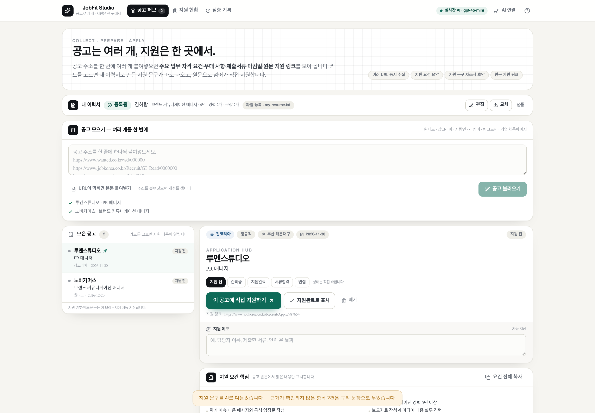
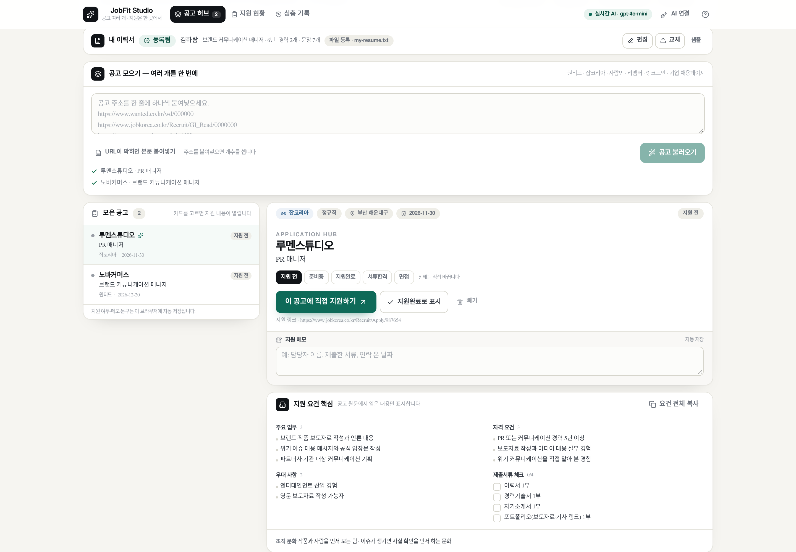
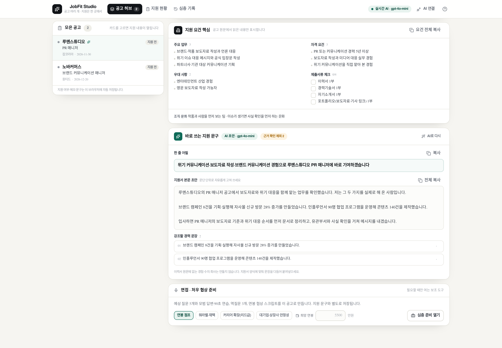
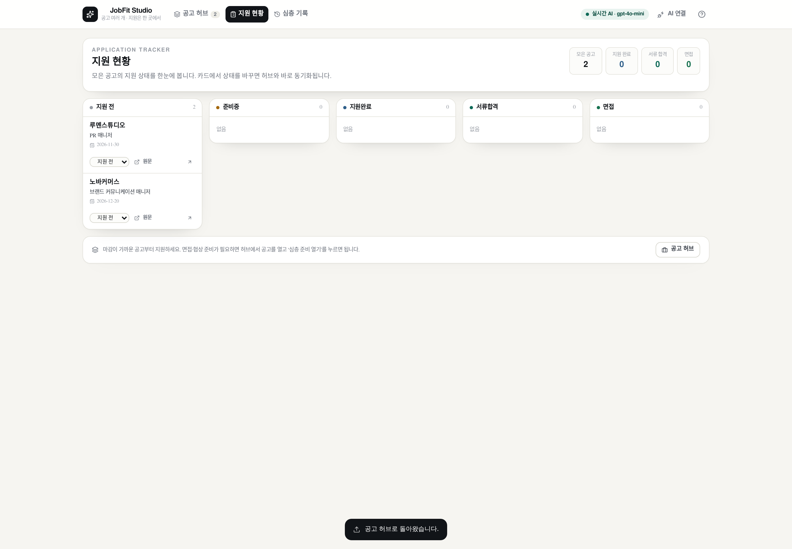
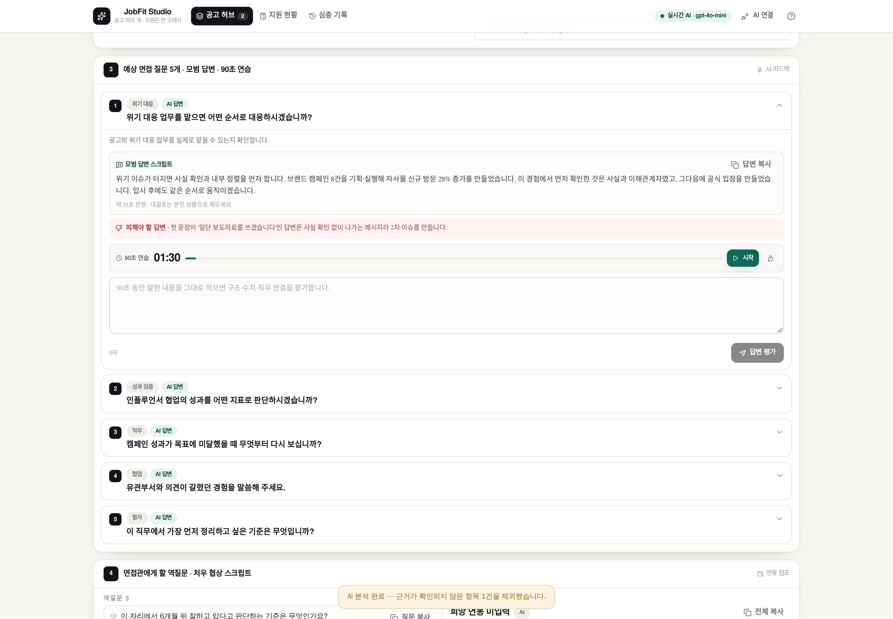
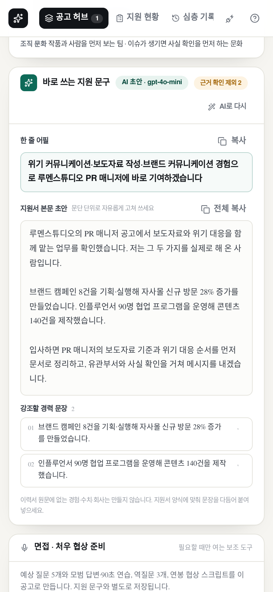

# JobFit Studio — 공고는 여러 개, 지원은 한 곳에서

> **공고 주소를 한 번에 여러 개 붙여넣으면, 각 공고의 주요 업무·자격 요건·우대 사항·제출서류·마감일·원문 지원 링크를 모아 옵니다.**
> 카드를 고르면 저장해 둔 내 이력서로 만든 **한 줄 어필·지원서 초안**이 바로 나오고, **‘이 공고에 직접 지원하기’**로 원문에 넘어가 바로 지원합니다.
> 지원 상태(지원 전 → 준비중 → 지원완료 → 서류합격 → 면접)와 메모도 같은 카드에서 관리합니다.


적합도 점수를 매기는 도구가 아니라, **여러 공고의 지원 내용을 끌어와 지원 준비를 끝내고 직접 지원까지 이어지는 허브**입니다.

- **여러 공고를 한 번에**: 원티드·잡코리아·사람인·리멤버·링크드인·노션·기업 채용페이지 주소를 줄바꿈으로 여러 개 넣고 한 번에 불러옵니다(최대 3개씩 동시 수집).
- **공고 원문에서 직접**: 회사·직무·주요 업무·자격 요건·우대 사항·제출서류·마감일과 **원문 ‘지원하기’ 링크**를 페이지 HTML/JSON-LD에서 읽습니다. 없는 항목은 만들지 않습니다.
- **이력서는 1회 등록**: `.txt`/`.md`/`.pdf` 또는 직접 입력. 브라우저에 저장되어 모든 공고 카드에 재사용됩니다.
- **지원 문구**: 규칙 엔진이 이력서 문장을 골라 한 줄 어필·지원서 3문단 초안·강조 경력 문장을 즉시 만들고, AI(Gemini `gemini-3.5-flash-lite`)가 연결되면 자동으로 한 번 더 다듬습니다. 원문에 없는 수치·회사명은 사후 검증에서 걸러냅니다.
- **직접 지원**: 카드의 ‘이 공고에 직접 지원하기’가 원문 지원 링크를 새 탭으로 엽니다. 지원 후 상태를 바꾸고 메모를 남깁니다.
- **보조 도구**: 면접 예상 질문 5개·모범 답변·90초 연습, 역질문, 처우 협상은 필요할 때만 ‘심층 준비 열기’로 엽니다.

---

## 1. 쓰는 순서

| | |
| --- | --- |
|  |  |
| **① 공고 여러 개 모으기** — 주소를 한 줄에 하나씩 붙여넣고 ‘공고 N개 불러오기’. 왼쪽 목록에 회사·직무·마감·상태가 쌓이고, 카드를 고르면 오른쪽에 지원 내용이 열립니다. | **② 지원 요건 핵심** — 주요 업무·자격 요건·우대 사항을 원문 그대로, 제출서류는 체크리스트로. ‘요건 전체 복사’로 지원서 작성에 바로 씁니다. |
|  |  |
| **③ 바로 쓰는 지원 문구** — 내 이력서로 만든 한 줄 어필·지원서 본문 초안·강조 경력 문장. 항목별 복사 버튼, ‘AI로 다시’ 다듬기, 근거 확인 제외 표시. | **④ 지원 현황** — 지원 전·준비중·지원완료·서류합격·면접 5단계로 모아 봅니다. 카드에서 상태를 바꾸면 허브와 즉시 동기화되고, 원문 링크도 남습니다. |
|  |  |
| **⑤ 필요할 때만 심층 준비** — 예상 질문·모범 답변·90초 연습·역질문·연봉 협상 스크립트. 지원 문구와 별도 패키지로 저장됩니다. | 모바일 390px에서도 같은 동선. 공고 목록 → 요건·제출서류 → 지원 문구 → 직접 지원. |

---

## 2. 핵심 기능

| 영역 | 내용 |
| --- | --- |
| **여러 공고 수집** | 줄바꿈·쉼표로 구분한 URL을 최대 12개까지 인식, 최대 3개씩 동시에 서버 수집. 실패한 주소는 나머지를 막지 않고 이유를 표시하며 **본문 붙여넣기 칸에 주소를 미리 채워** 줍니다. 같은 공고는 중복 저장하지 않습니다 |
| **공고 파싱** | 서버에서 HTML fetch(12초·1.8MB·본문 6,000자 제한, 사설망 SSRF 차단) → JSON-LD `JobPosting`·`og:` 메타·본문 문단 분리 → 필요하면 AI가 회사·직무·담당 업무·자격 요건·우대 사항·**제출서류**·조직 톤으로 정리. 원문에 없는 숫자가 섞이면 그 필드는 페이지 글자 기준값으로 되돌립니다 |
| **원문 지원 링크** | 페이지 앵커의 ‘지원하기·입사지원·Apply’ 문구와 경로를 점수화해 **직접 지원 링크**를 뽑고, 없으면 공고 URL을 씁니다. AI가 만든 링크는 받지 않습니다 |
| **차단 사이트 대응** | `403/401/429`·비HTML·본문 부족이면 `422`와 사이트별 안내. **본문 붙여넣기 칸이 자동으로 열리고**, 주소·차단 페이지 글자를 미리 채워 줍니다 |
| **이력서 1회 등록** | `.txt`/`.md` 파싱, **`.pdf` 텍스트 추출**(ToUnicode CMap·FlateDecode, 스캔 PDF는 안내), 직접 입력 편집 시트. `localStorage`에 저장 |
| **지원 문구(규칙)** | 이력서 문장과 공고 키워드의 겹침으로 강조 문장을 고르고, 공고의 첫 업무·우대/자격 항목을 인용해 한 줄 어필·3문단 지원서 초안을 만듭니다. 모든 수치는 이력서 원문 값만 사용 |
| **지원 문구(AI)** | `apply_kit` 모드 — `gemini-3.5-flash-lite`. 카드를 처음 열 때 규칙 문안을 즉시 보여 주고, AI가 연결돼 있으면 자동으로 한 번 다듬습니다. 숫자·회사명 사후 검증(`src/lib/guard.ts`)에서 걸린 항목은 규칙 문장으로 되돌리고 개수를 표시 |
| **직접 지원·상태** | ‘이 공고에 직접 지원하기’ → 원문 링크 새 탭. 상태 5단계(지원 전/준비중/지원완료/서류합격/면접), 지원 메모, 제출서류 체크. 모두 localStorage에 자동 저장 |
| **지원 현황** | 상태별 5열 보드, 모은 공고·지원 완료·서류 합격·면접 수, 카드에서 상태 변경·원문 링크·허브로 열기 |
| **심층 준비(보조)** | 예상 질문 5개·모범 답변·피해야 할 답변·90초 타이머·답변 평가, 역질문 3개, 처우 협상(첫 제안·차액 대응·비연봉 카드), 이직 우선순위·희망 연봉. 패키지 20건 저장·비교, Markdown/인쇄 |
| **정직성 가드** | 프롬프트 규칙 + 클라이언트 검증: 원문에 없는 숫자·회사명이 든 문장은 폐기하고 경고 수를 남깁니다 |

---

## 3. AI 연결 (Vercel)

```
api/analyze.ts      POST /api/analyze (mode: job_url | apply_kit | package | interview_eval | recommend), GET /api/analyze (상태 프로브)
api/_joburl.ts      공고 URL fetch·HTML 텍스트 추출·문단 분리·지원 링크 추출 (Vercel 라우트 아님: `_` 접두사)
vercel.json         build: npm run build → dist, functions.maxDuration 60s
```

### 환경변수

| 이름 | 필수 | 설명 |
| --- | --- | --- |
| `GEMINI_API_KEY` | 배포 시 권장 | Google AI Studio 키(`AQ.…` 또는 `AIza…`). 서버에서만 사용 |
| `GEMINI_MODEL` | 선택 | 기본 `gemini-3.5-flash-lite` |
| `OPENAI_API_KEY` | 선택 | Gemini 키가 없을 때 상용 OpenAI 경로 |
| `OPENAI_MODEL` | 선택 | 기본 `gpt-4o-mini` (허용: `gpt-4o-mini`, `gpt-4o`, `gpt-4.1-mini`, `gpt-4.1`) |
| `OPENAI_BASE_URL` / `GEMINI_BASE_URL` | 선택 | 프록시·게이트웨이를 쓸 때만 |
| `JOBFIT_ALLOW_LOCAL_FETCH` | 테스트 전용 | `1`이면 `127.0.0.1` 등 로컬 주소 fetch 허용(E2E 픽스처용). 운영에서는 두지 마세요 |

키가 없으면 `job_url`은 **규칙 정리**로 동작하고, `apply_kit`·`package`·`recommend`는 `501 no_key`를 돌려주며 앱은 규칙 문안으로 폴백합니다.

### API 계약

```
GET  /api/analyze
→ { ok, service, version, ai, provider: "gemini"|"openai"|null, model, reason?: "no_key",
    modes: ["package","interview_eval","job_url","recommend","apply_kit"], urlFetch: true }

POST /api/analyze  { mode:"job_url", jobUrl, apiKey?, model? }        ← AI 키 없이도 200
→ { ok, mode, engine: "ai"|"rule", provider, model,
    job:{company,role,employmentType,location,deadline,responsibilities,requirements,preferred,
         documents,applyUrl,applyLabel,tone},
    meta:{url, finalUrl, site, title, chars, note} }
→ 422 { ok:false, error:{ code:"fetch_blocked"|"fetch_failed"|"not_job_page"|"too_large", message, site, excerpt } }
→ 400 { error:{ code:"bad_url" } }

POST /api/analyze  { mode:"apply_kit", job, resume, apiKey?, model? }
→ { ok, mode, provider, model, data:{ oneLiner, coverLetter, keyPoints[] } }

POST /api/analyze  { mode:"package", job, resume, match, priorityLabel?, targetSalary?, apiKey?, model? }
→ { ok, mode, provider, model, data:{ fit{verdict,onePoint,strengths,gaps}, intro{text,outline}, appeals[],
     rewrites[], questions[]{question,why,category,answer,avoid}, reverseQuestions[], negotiation{opener,counter,nonSalary,questions} } }

POST /api/analyze  { mode:"interview_eval", question, answer, seconds, job?, resume?, apiKey?, model? }
→ { ok, mode, provider, model, data:{ strengths[], improvements[], followUp, followUpWhy, score, verdict } }

POST /api/analyze  { mode:"recommend", resume, priorityLabel?, apiKey?, model? }
→ { ok, mode, provider, model, data:{ titles[{title,why}], salaryBand{min,max,basis}, targets[{group,why}] } }
```

- 키 우선순위: `GEMINI_API_KEY` → `OPENAI_API_KEY` → 요청 `apiKey`(서버 키가 없을 때만, `sk-…`가 아니면 Gemini) → `501 no_key`
- JSON 모드, 본문 60,000자 / 필드 3,500자 / 답변 3,000자 제한, CORS(`*`, OPTIONS 204)
- 공고 URL fetch: 12초 타임아웃, 1.8MB·본문 6,000자 제한, 리다이렉트 후 최종 호스트 재검사, 사설망·로컬 차단
- 입력과 키는 저장하지 않습니다.

---

## 4. 실행

```bash
npm install
npm run dev        # http://localhost:5183 (서버가 없으므로 공고 URL은 본문 붙여넣기로 안내)
npm run build      # tsc --noEmit + tsc -p tsconfig.api.json + vite build
npm run preview    # 빌드 결과 확인
```

### AI·URL 수집까지 로컬에서 보기

```bash
npm i -g vercel
vercel dev         # .env.local 에 GEMINI_API_KEY(또는 OPENAI_API_KEY)를 두면 실시간 AI + 공고 URL 수집
```

### 테스트

```bash
python3 scripts/verify.py     # Playwright E2E (모의 서버 5종: OpenAI·Gemini·키 없음·정적 호스팅·사설망 차단)
node scripts/test-pdf.mjs     # 한글 PDF 텍스트 추출 단위 테스트
python3 scripts/make-pdf-fixture.py
python3 scripts/shots.py      # docs/screenshots 재생성
```

`scripts/e2e-server.mjs`가 `dist/`를 서빙하면서 실제 `api/analyze.ts`를 esbuild로 실행하고, 공고 페이지(`wanted.co.kr` → `job-page.html`, `jobkorea.co.kr` → `job-page-2.html`)와 AI 응답만 스텁합니다. 픽스처의 인물·기업은 모두 가상입니다.

---

## 5. 배포

- **Vercel**: 저장소를 연결하면 `vercel.json` 설정으로 `dist` + `api/analyze.ts`가 함께 배포됩니다. `GEMINI_API_KEY`를 넣고 재배포하면 배지가 ‘실시간 AI’로 바뀌고 공고 URL 수집·지원 문구 AI가 켜집니다.
- **GitHub Pages**: `.github/workflows/deploy.yml` + `vite.config.ts`의 `GITHUB_ACTIONS` base 분기로 정적 배포도 지원합니다. 서버가 없으므로 공고 URL은 안내 문구와 함께 **본문 붙여넣기**로 동작하고, 지원 문구는 규칙 엔진으로 만듭니다.

---

## 6. 데이터·한계

- 이력서·모은 공고·지원 문구·상태·메모·심층 패키지는 **브라우저 localStorage**에만 저장됩니다(공고 40건, 패키지 20건).
- 공고 URL은 **공개 페이지**만 읽습니다. 로그인 필요·자동 수집 차단 사이트는 본문 붙여넣기를 사용하세요(같은 정리를 받습니다).
- 지원 링크는 페이지에 실제로 있는 ‘지원하기’ 앵커를 읽습니다. 공고가 앱 안에서만 지원을 받으면 공고 URL로 열립니다.
- AI는 입력 내용을 Gemini/OpenAI로 전송합니다. 실제 회사 기밀, 타인의 개인정보, 채용 사이트의 비공개 자료는 넣지 마세요.
- 지원 문구는 **초안**입니다. 제출 전 모든 문장과 수치를 지원자가 직접 확인해야 하며, AI 출력은 수치·회사명 사후 검증을 거칩니다.
- 적합도(심층 준비 화면)는 참고값이며 서류 통과를 보장하지 않습니다. **연봉 참고 범위는 추정**이고, 협상 문장에 들어가는 금액은 입력한 희망 연봉만 씁니다.
- PDF는 글자로 된 문서만 읽습니다(스캔 이미지·암호화 PDF는 안내 후 .txt/.md 권장).
