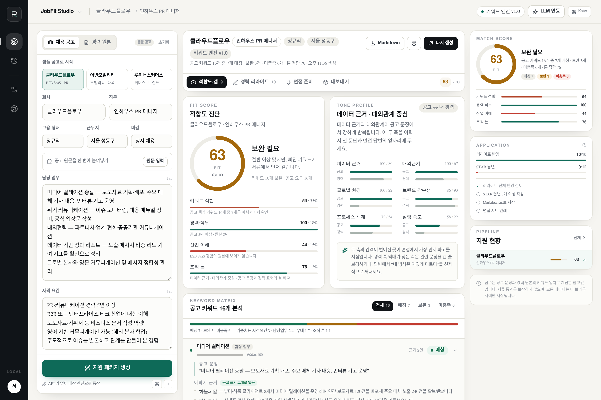
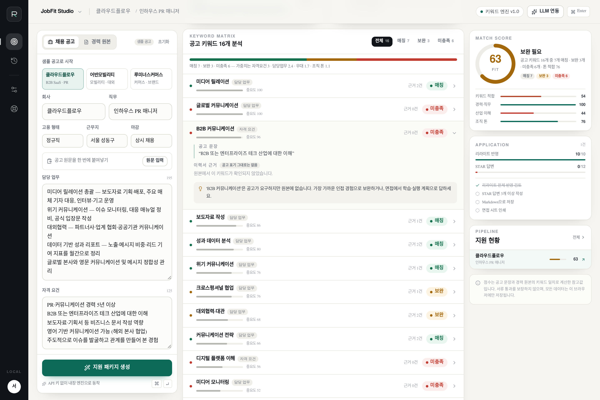
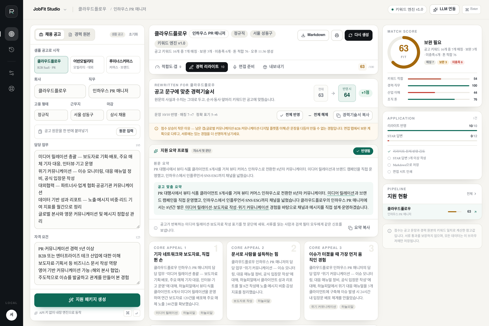
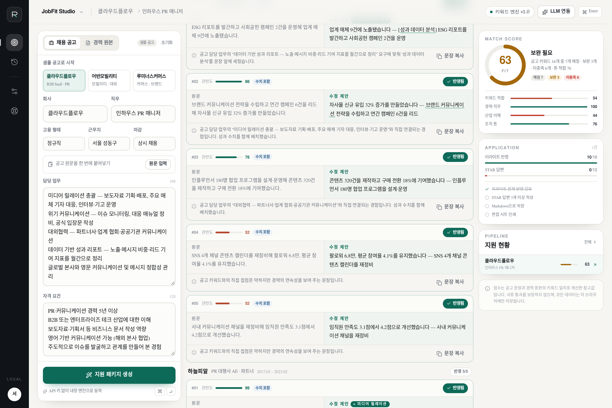
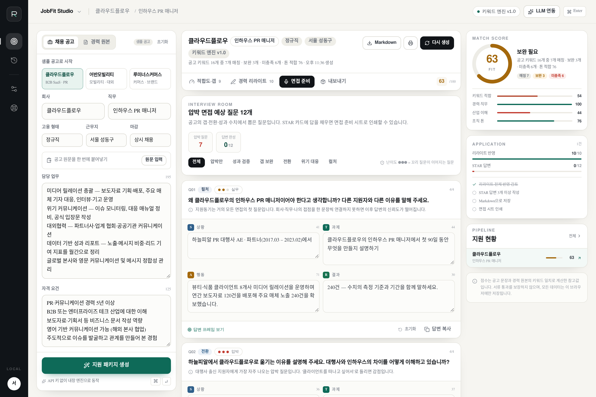
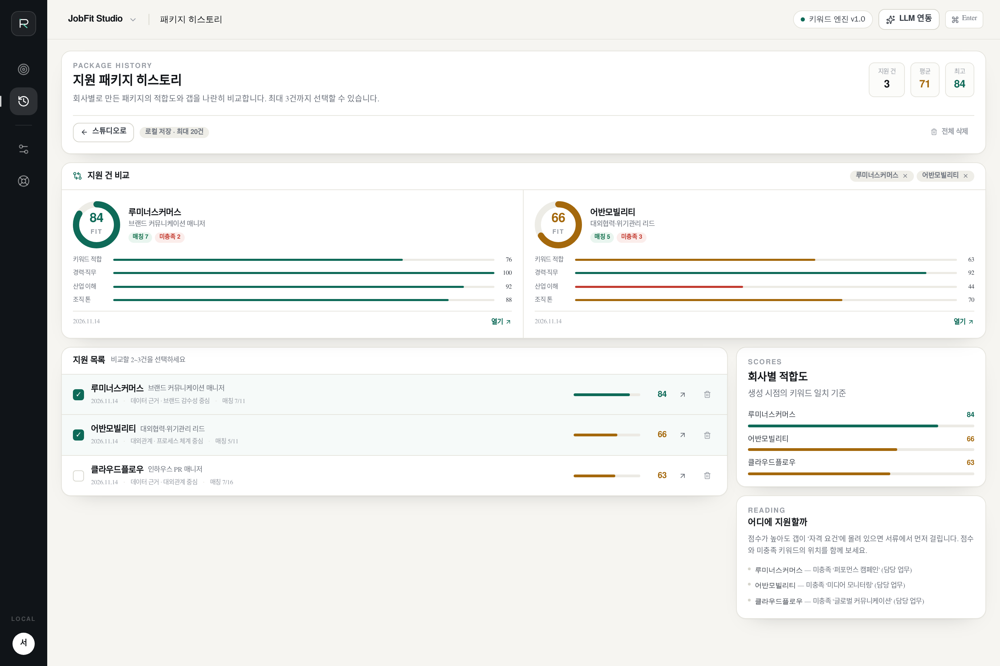
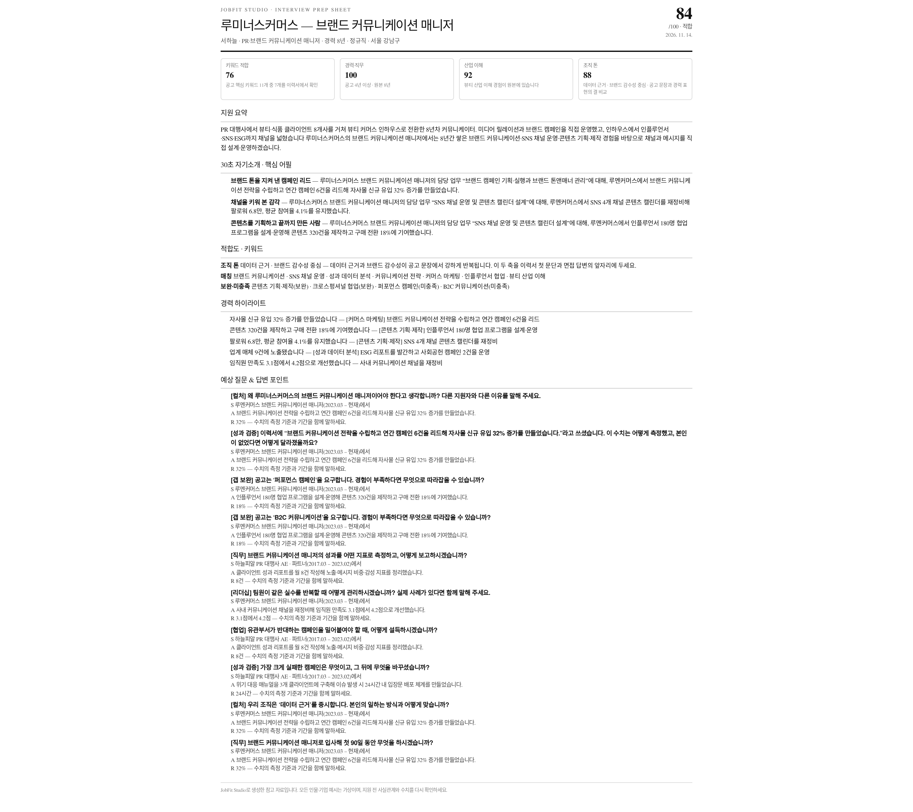

# JobFit Studio — 공고 맞춤 이력서·면접 패키지 생성기

> **채용 공고 한 편과 경력 원본 하나로, 서류와 면접을 같은 언어로 맞춥니다.**
> 적합도·갭 분석 → 공고 문구에 맞춘 경력기술서 리라이트 → 압박 면접 질문과 STAR 답변 → 저장·내보내기까지 한 화면에서.



지원은 “좋은 이력서를 쓰는 일”이 아니라 **이 공고가 반복하는 언어로 내 경험을 다시 배열하는 일**입니다. JobFit Studio는 공고에서 핵심 키워드와 조직 톤을 뽑아 내 경력 원본과 대조하고, 무엇이 맞고 무엇이 비었는지 보여 준 뒤, 그 자리에서 문장을 고쳐 줍니다. API 키 없이 내장 키워드 엔진만으로 동작합니다.

---

## 1. 핵심 기능

| 영역 | 내용 |
| --- | --- |
| **입력** | 경력 원본(경력·성과 문장·스킬·산업)을 localStorage에 저장·편집. 샘플 3종 1클릭 로드. 채용 공고는 문단별 입력 또는 **원문 붙여넣기 → 자동 문단 분리** |
| **적합도·갭** | 0~100 적합도 게이지, 4개 축(키워드 55% · 경력/직무 18% · 산업 15% · 조직 톤 12%) 분해, 공고 키워드 16개 내외의 매칭/보완/미충족 판정과 근거 문장 |
| **조직 톤** | 공고 문장의 6개 축(실행 속도·데이터 근거·대외관계·브랜드 감수성·프로세스 체계·글로벌)을 내 경력 표현과 나란히 비교 |
| **경력 리라이트** | 지원 요약(자소서 첫 문단) + 경력 문장별 before/after diff. 성과 수치 앞당김, 약한 동사 교체, 공고 표기 앞머리 부착. 문장별 **반영/해제**, 전체 반영, 1클릭 복사 |
| **핵심 어필 3** | 공고 요구 ↔ 내 증거를 연결한 카드 3장. 어떤 공고 문장에 대응하는지 명시 |
| **압박 면접** | 공고의 갭·전환·성과 수치에서 뽑은 질문 12개. 카테고리·난이도 필터, 질문별 **STAR 4칸 편집**, 답변 프레임 힌트, 복사 |
| **히스토리** | 회사별 패키지 자동 저장(최대 20건), 적합도·축별 점수·갭을 2~3건 나란히 비교, 회사별 점수 막대 |
| **내보내기** | Markdown 패키지 다운로드, 인쇄용 면접 준비 시트(A4 1~2장, PDF 저장), 경력기술서 문단 복사 |
| **LLM 연동(선택)** | OpenAI 호환 / Anthropic 키를 넣으면 어필 포인트·리라이트·질문을 한 번 더 보정. 실패해도 내장 엔진 결과 유지 |

### ① 적합도와 갭 — “무엇이 비었는지” 먼저



- 공고의 담당 업무·자격 요건·우대 사항을 구분해 가중치를 다르게 둡니다(자격요건 3 · 담당업무 2.4 · 우대 1.7 · 조직 톤 1.1).
- 키워드는 사전 기반 동의어 묶음으로 인식합니다. 공고가 “미디어 릴레이션”이라 써도 이력서의 “보도자료·기자 대응”을 같은 역량으로 잡습니다.
- 각 키워드마다 **공고 원문 문장**, **이력서 근거 문장**, **정확 표기 여부**, 그리고 지금 할 일을 함께 보여 줍니다.
- 매칭/보완/미충족을 색으로 구분하고, 가중치가 높은 미충족부터 “먼저 메울 갭”으로 정리합니다.

### ② 경력 리라이트 — 사실은 그대로, 배열만 공고에 맞춰





- 성과 수치가 문장 뒤에 있으면 앞으로 당깁니다. `…운영해 노출 240건을 확보했습니다` → `노출 240건을 확보했습니다 — …운영`
- `담당`·`참여` 같은 약한 동사를 `운영`·`수행`으로 바꾸고, 공고가 쓰는 표기를 문장 앞에 세웁니다.
- **없는 경험은 만들지 않습니다.** 공고 키워드가 원본 문장에 있을 때만 표기를 붙이고, 점수가 크게 오르지 않으면 그 이유(남은 갭은 문장으로 메울 수 없음)를 그 자리에서 설명합니다.
- 반영/해제에 따라 예상 적합도·매칭 키워드·정확 표기 수가 실시간으로 바뀝니다.

### ③ 압박 면접 — 갭에서 질문이 나옵니다



- 대행사→인하우스 전환, 성과 수치 검증, 미충족 키워드, 위기 대응, 조직 톤 등 공고와 원본의 접점에서 질문을 조립합니다.
- 질문마다 **왜 묻는지**, **연결된 갭**, **STAR 초안**(경력 원본의 실제 문장)을 채워 둡니다. 수치는 원문에 있는 값만 씁니다.
- 답변은 카드에서 바로 고치고, 면접 준비 시트로 인쇄해 한 장으로 들고 갈 수 있습니다.

### ④ 히스토리와 내보내기



- 회사별 적합도·축별 점수·매칭/미충족을 나란히 비교합니다.
- Markdown 패키지에는 적합도 표, 키워드 표, 어필 포인트, 리라이트, STAR 답변, 체크리스트가 모두 들어갑니다.
- 인쇄 시트는 지원 요약, 어필 3줄, 키워드 요약, 경력 하이라이트, 예상 질문을 담습니다.



---

## 2. 어떻게 계산하나

| 단계 | 방식 |
| --- | --- |
| 키워드 추출 | 40여 개 역량 사전(동의어·영문 표기 포함)을 공고 문단에 대조. 등장 문단의 가중치 × 반복 횟수로 중요도 산출 |
| 이력서 매칭 | 경력 문장·요약·스킬 전체에서 동의어 등장 횟수와 **공고 표기 그대로의 존재 여부**를 함께 반영. 1회는 보완, 2회 이상 + 정확 표기는 매칭 |
| 축 점수 | 키워드 55% · 경력/직무 18%(연차·직함) · 산업 15% · 조직 톤 12% |
| 톤 분석 | 6개 축의 신호어를 공고와 경력에서 각각 세어 0~100으로 정규화, 간격이 큰 축을 면접 포인트로 제시 |
| 리라이트 | 규칙 기반. 수치 절 앞당김 → 약한 동사 교체 → 공고 표기 부착. 반영한 문장으로 적합도를 다시 계산해 “반영 시 점수”를 표시 |
| 질문 생성 | 전환 여부, 상위 미충족·보완 키워드, 위기/대외/리딩 요구, 톤 축, 수치 보유 여부를 조건으로 질문 조립 |

점수는 **키워드 일치 기반의 참고값**입니다. 서류 통과를 보장하지 않으며, 같은 경험도 공고에 따라 다르게 읽힌다는 것을 보여 주는 도구입니다.

---

## 3. 실행

```bash
cd projects/job-fit-studio
npm install
npm run dev        # http://localhost:5183
npm run build      # tsc --noEmit && vite build
npm run preview    # http://localhost:4183
```

- Node 22, Vite 7, React 19, TypeScript 5.9, Tailwind CSS 4, lucide-react
- 검증: `python3 scripts/verify.py` (preview 서버 실행 후) — 기능 체크 38개, 콘솔·페이지 에러 0
- 스크린샷: `python3 scripts/shots.py`

---

## 4. 개인정보와 한계

- 경력 원본·지원 패키지·API 키는 **이 브라우저의 localStorage에만** 저장됩니다. 서버로 보내지 않습니다.
- LLM을 켜면 생성 시 입력한 경력·공고가 해당 API(OpenAI/Anthropic)로 직접 전송됩니다. 켜지 않으면 외부 호출이 없습니다.
- 예시 인물(서하늘·윤도현·한지우)과 기업(클라우드플로우·어반모빌리티·루미너스커머스 등)은 **모두 가상**입니다.
- 실제 회사 기밀, 타인의 개인정보, 채용 사이트의 비공개 자료는 넣지 마세요.
- 리라이트는 원문의 사실과 수치를 유지하는 선에서 문장을 재배열합니다. 제출 전 회사명·기간·직함과 수치의 측정 기준을 다시 확인하세요.

---

## 5. 구조

```
src/
  App.tsx                  상태·생성 파이프라인·레이아웃
  types.ts                 도메인 타입
  lib/
    korean.ts              키워드 사전·정규화·공고 문단 파싱
    engine.ts              매칭·톤·리라이트·어필·질문·재계산
    presets.ts             가상 경력 원본 3종 · 공고 3종
    storage.ts             localStorage
    report.ts              Markdown·파일명
    llm.ts                 OpenAI/Anthropic 보정
  components/
    Sidebar · TopBar · InputPanel · Rail · HistoryView · EmptyState
    ApiModal · PrintSheet · ui.tsx
    tabs/MatchTab · RewriteTab · InterviewTab · ExportTab
docs/screenshots/          데스크톱·태블릿·모바일·인쇄 화면
scripts/                   Playwright 검증·스크린샷
```

---

*JobFit Studio · 채용 공고 맞춤 이력서·면접 패키지 생성기*
