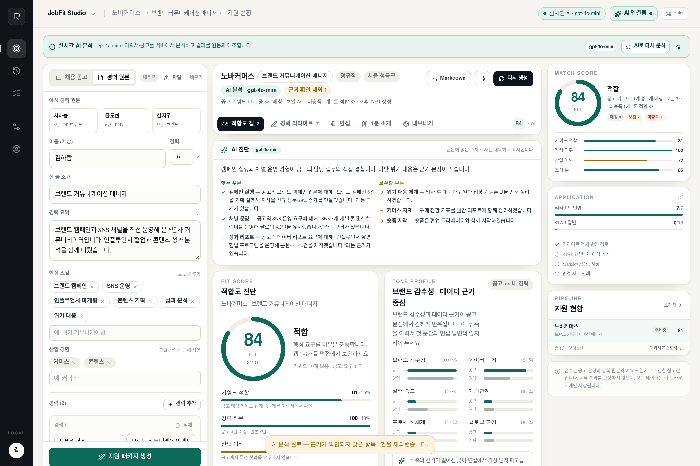
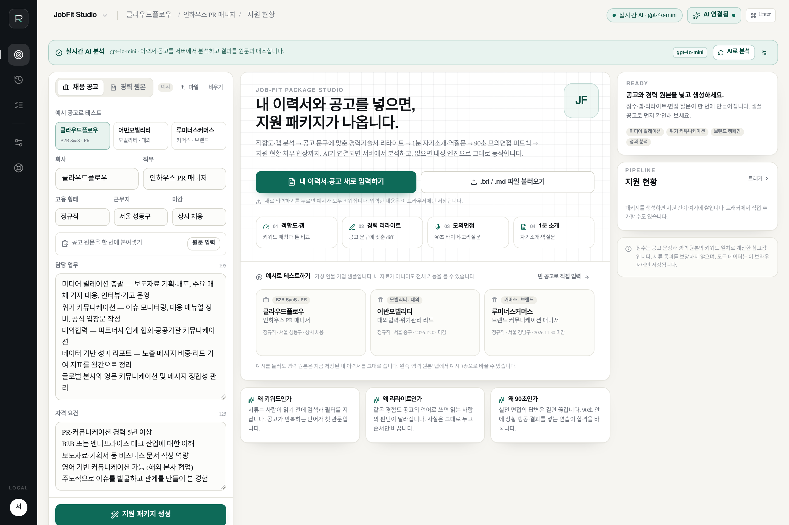
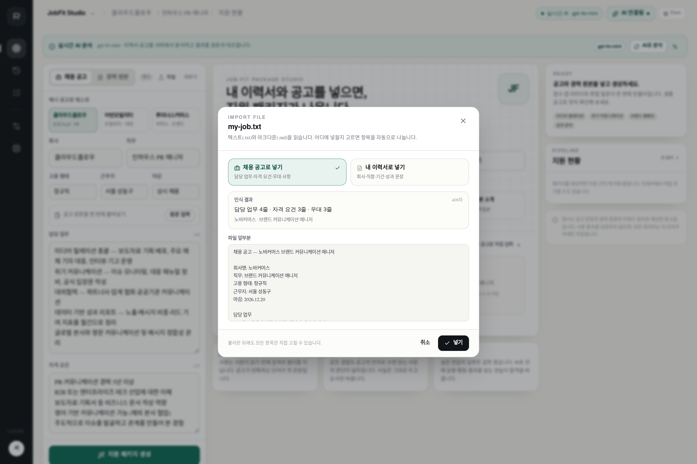
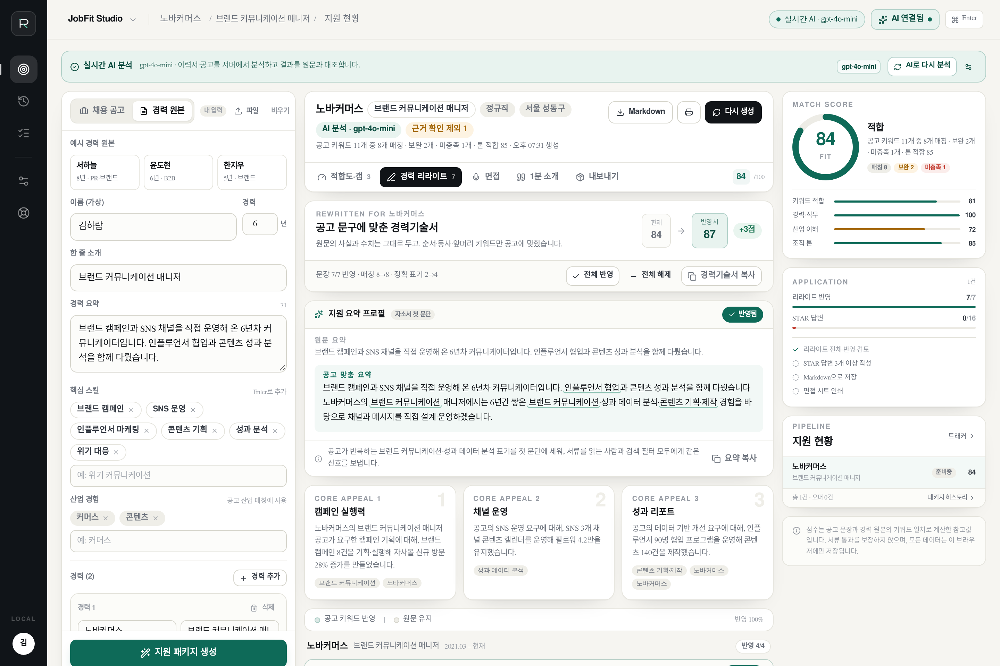
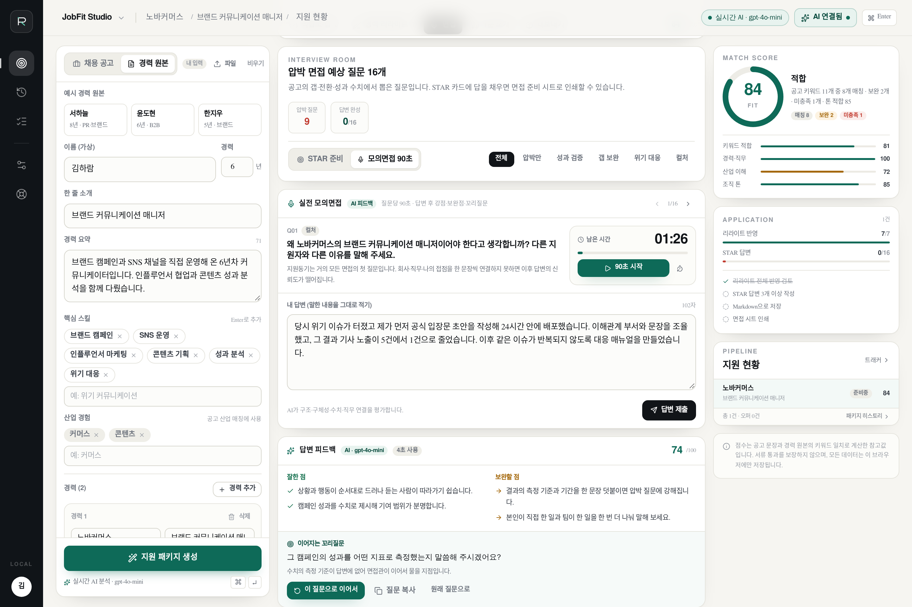
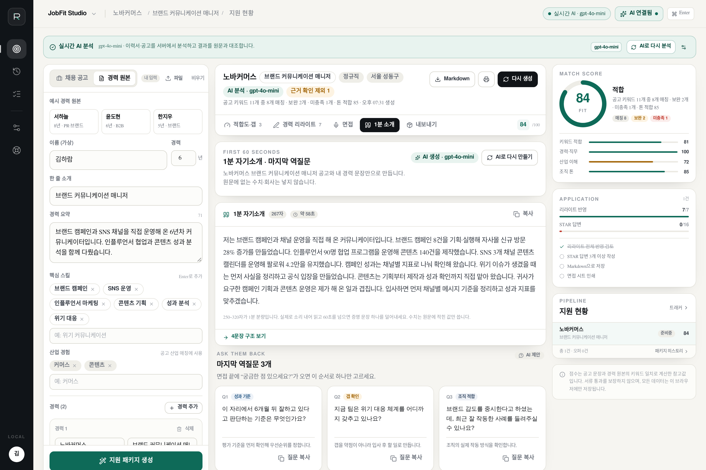
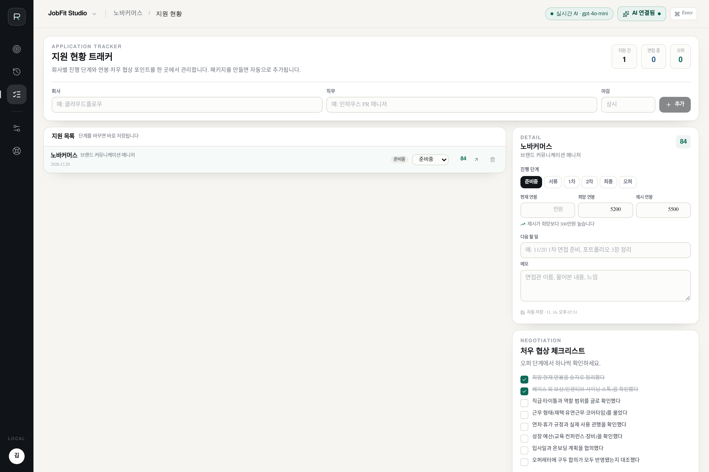
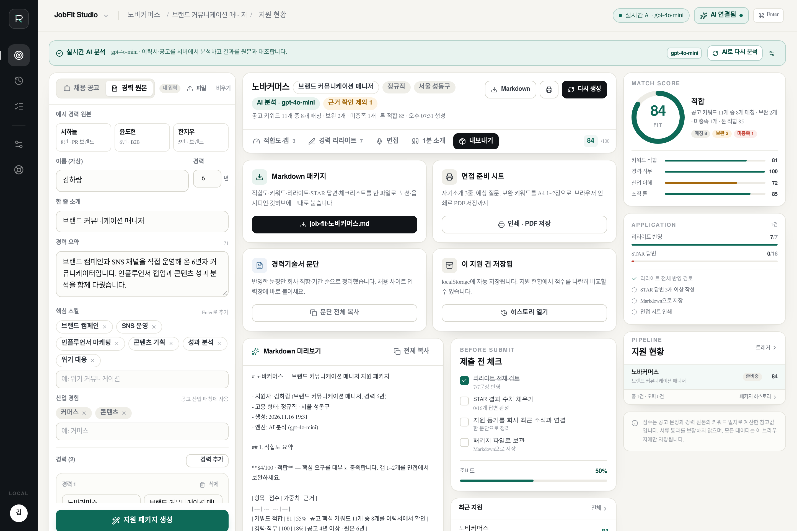
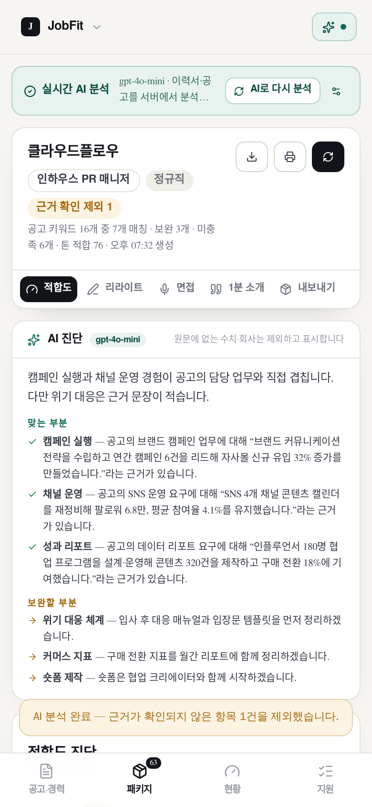
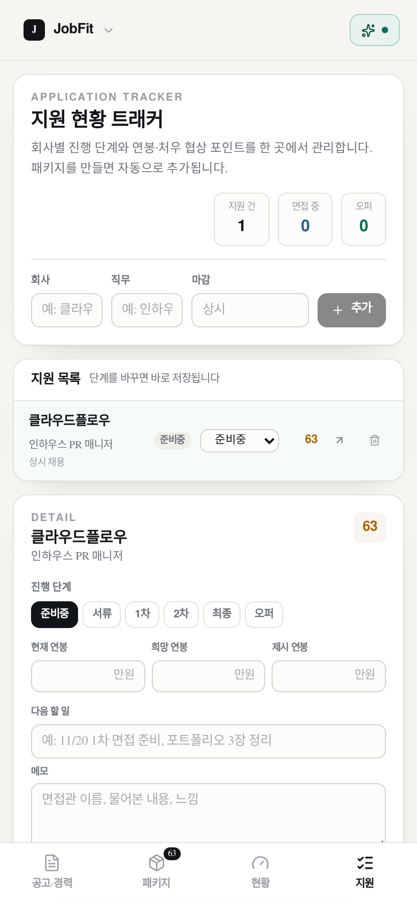

# JobFit Studio — 실전형 AI 이력서·면접 코치

> **내 이력서와 공고 한 편을 넣으면, 서류와 면접을 같은 언어로 맞춥니다.**
> 적합도·갭 분석 → 공고 문구에 맞춘 경력기술서 리라이트 → 1분 자기소개·역질문 → 90초 모의면접 피드백 → 지원 현황·처우 협상까지 한 화면에서.



정적 규칙 데모가 아니라, **실제 구직자가 자기 이력서(.txt/.md)와 채용 공고를 넣고 바로 쓸 수 있는** 도구입니다.

- **AI 연결 시**: Vercel 서버리스 함수(`/api/analyze`)가 OpenAI `gpt-4o-mini`로 분석합니다.
- **AI 미연결 시**: 내장 규칙 엔진으로 모든 기능이 그대로 동작하고, 상단 배너가 현재 모드를 알려 줍니다.
- **정직성 원칙**: 지원자 원문에 없는 경험·수치·회사는 AI도, 규칙 엔진도 만들지 않습니다.

---

## 1. 화면

| | |
| --- | --- |
|  |  |
| 내 이력서·공고로 시작하기(비우기) / .txt·.md 불러오기, 예시는 ‘예시로 테스트하기’로 분리 | 파일을 읽어 공고/이력서 중 어디로 넣을지 고르고, 인식 결과와 경고를 먼저 보여 줌 |
|  |  |
| 문장별 Before/After, 반영/해제에 따라 예상 점수 실시간 변동 | 갭·전환·성과 수치에서 뽑은 질문 + STAR 카드 |
|  |  |
| 질문당 90초 타이머, 답변 제출 → 강점·보완점·꼬리질문 | AI가 만든 1분 자기소개(250~320자)와 마지막 역질문 3개 |
|  |  |
| 단계(준비중→서류→1차→2차→최종→오퍼)와 처우 협상 체크리스트 | Markdown 패키지·면접 준비 시트(인쇄/PDF) |
|  |  |
| 모바일 390px에서도 가로 넘침 없이 | 지원 현황도 모바일에서 바로 |

---

## 2. 핵심 기능

| 영역 | 내용 |
| --- | --- |
| **입력** | ① 내 이력서·공고 새로 입력(비우기) ② `.txt/.md` 파일 불러오기(공고/이력서 자동 인식 + 확인 창) ③ 예시 3종은 ‘예시로 테스트하기’로 분리. 공고는 **원문 붙여넣기 → 문단 자동 분리**, 이력서는 회사·직함·기간·성과 문장 자동 파싱 |
| **실시간 AI 분석** | `/api/analyze` 연결 시 AI 진단(맞는 부분/보완할 부분), 어필 포인트, 리라이트, 질문, 1분 소개, 역질문을 서버에서 생성. 결과는 원문과 2차 대조 후 반영 |
| **모드 배너** | 상단에 `실시간 AI 분석` / `로컬 규칙 모드`와 사유(키 없음·서버 미연결·한도·오류)를 표시하고 **AI로 다시 분석** 버튼 제공 |
| **적합도·갭** | 0~100 점수, 4축(키워드 55%·경력/직무 18%·산업 15%·조직 톤 12%), 공고 키워드 16개 내외 매칭/보완/미충족 + 근거 문장 |
| **경력 리라이트** | 지원 요약 + 문장별 before/after. 성과 수치 앞당김, 약한 동사 교체, 공고 표기 부착. 문장별 반영/해제, 전체 반영 |
| **1분 자기소개·역질문** | 공고와 내 경력 문장만으로 250~320자 자기소개(글자수·예상 발화 초 표시) + 마지막 역질문 3개(질문·의도·톤). 규칙/AI 생성 구분 배지 |
| **실전 모의면접** | 질문별 **90초 카운트다운**(일시정지·재시작), 답변 입력 후 평가: 강점·보완점 각 3개, 점수, **꼬리질문 1개**. ‘이 질문으로 이어서’로 압박 연쇄 연습. 피드백은 패키지에 저장 |
| **지원 현황 트래커** | 패키지를 만들면 자동 등록. 단계 변경, 다음 할 일, 메모, 마감, 연결된 패키지 열기. **처우 협상 체크리스트 8항목**과 연봉(현재/희망/제시, 만원) 차이 계산 |
| **히스토리·내보내기** | 패키지 최대 20건 저장, 2~3건 나란히 비교. Markdown 패키지(자기소개·역질문·모의면접 피드백 포함), 인쇄용 면접 준비 시트 |
| **정직성 가드** | 프롬프트 규칙 + 클라이언트 검증(`src/lib/guard.ts`): 원문에 없는 숫자·회사명이 든 문장은 폐기하고 패키지에 경고 수를 남김 |

### 1분 자기소개 만들기

- 규칙 모드: 지원자가 쓴 성과 문장만 인용해 훅→증명→적합→마무리 4문장으로 조립하고, 320자 상한에 가장 가깝게 문장을 채웁니다(공백 제외 글자수 기준).
- AI 모드: 같은 구조를 프롬프트로 요청하되 250~320자·원문 수치만 사용을 강제합니다. 가드에서 수치/회사명이 어긋나면 규칙 결과로 자동 대체됩니다.

### 90초 모의면접

1. 질문 선택(이전/다음) → **90초 시작**
2. 말한 내용을 답변 칸에 그대로 적기 → **답변 제출**
3. 강점·보완점·점수·꼬리질문 확인 → **이 질문으로 이어서**로 다음 라운드
4. 피드백은 최근 5건까지 저장되어 면접 준비 시트와 Markdown에 함께 인쇄됩니다.

---

## 3. AI 연결 (Vercel)

```
api/analyze.ts      POST /api/analyze (mode: package | interview_eval), GET /api/analyze (상태 프로브)
vercel.json         build: npm run build → dist, functions.maxDuration 45s
```

### 환경변수

| 이름 | 필수 | 설명 |
| --- | --- | --- |
| `OPENAI_API_KEY` | 배포 시 권장 | 서버에서만 사용. 브라우저로 내려가지 않습니다. |
| `OPENAI_MODEL` | 선택 | 기본 `gpt-4o-mini`. 허용: `gpt-4o-mini`, `gpt-4o`, `gpt-4.1-mini`, `gpt-4.1` |
| `OPENAI_BASE_URL` | 선택 | 프록시/게이트웨이를 쓸 때만 (`https://api.openai.com/v1` 기본) |

키가 없으면 서버는 `501 no_key`를 돌려주고, 앱은 자동으로 **로컬 규칙 모드**로 동작합니다. 화면의 ‘AI 연결’에서 개인 키를 넣어 요청 1회에만 실어 보내는 폴백도 있지만(브라우저 저장, 서버 미저장), 배포 환경에서는 환경변수를 권장합니다.

### API 계약

```
GET  /api/analyze
→ { ok, service, version, ai: boolean, model, reason?: "no_key", modes: ["package","interview_eval"] }

POST /api/analyze  { mode:"package", job, resume, match, apiKey?, model? }
→ { ok, mode, model, data: { fit, intro{text,outline}, appeals[], rewrites[], questions[], reverseQuestions[] } }

POST /api/analyze  { mode:"interview_eval", question, answer, seconds, job?, resume?, apiKey?, model? }
→ { ok, mode, model, data: { strengths[], improvements[], followUp, followUpWhy, score, verdict } }
```

- 키 우선순위: `process.env.OPENAI_API_KEY` → 요청 `apiKey` → `501 no_key`
- JSON 모드(`response_format: json_object`), 본문 60,000자 / 필드 3,500자 / 답변 3,000자 제한
- 오류: `400 bad_mode|bad_job|bad_resume|bad_key|bad_question|bad_answer`, `413 too_large`, `501 no_key`, `502 upstream|bad_json`
- CORS(`*`, OPTIONS 204) 포함. 입력·키는 저장하지 않습니다.

---

## 4. 실행

```bash
npm install
npm run dev        # http://localhost:5183 (AI 없이 규칙 엔진으로 시작)
npm run build      # tsc --noEmit + tsc -p tsconfig.api.json + vite build
npm run preview    # 빌드 결과 확인
```

### AI 붙여서 로컬에서 보기

`vercel dev`로 띄우면 `/api/analyze`가 함께 동작합니다.

```bash
npm i -g vercel
vercel dev         # 프로젝트 연결 후 OPENAI_API_KEY 를 .env.local 에 두면 실시간 AI 모드
```

### 테스트

```bash
python3 scripts/verify.py    # Playwright E2E (모의 API 서버 3종: 키 있음/키 없음/정적 호스팅)
python3 scripts/shots.py     # docs/screenshots 재생성
```

`scripts/e2e-server.mjs`가 `dist/`를 서빙하면서 실제 `api/analyze.ts`를 esbuild로 실행하고 OpenAI만 스텁합니다. 테스트 픽스처(`scripts/fixtures/`)는 모두 가상 인물·기업입니다.

---

## 5. 배포

- **Vercel**: 저장소를 연결하면 `vercel.json` 설정으로 `dist` + `api/analyze.ts`가 함께 배포됩니다. 환경변수 `OPENAI_API_KEY`를 넣고 재배포하면 배너가 ‘실시간 AI 분석’으로 바뀝니다.
- **GitHub Pages**: `.github/workflows/deploy.yml` + `vite.config.ts`의 `GITHUB_ACTIONS` base 분기로 정적 배포도 그대로 지원합니다. 이 경우 `/api/analyze`가 없으므로 자동으로 로컬 규칙 모드로 동작합니다.

---

## 6. 데이터·한계

- 이력서·공고·패키지·지원 현황·모의면접 기록은 **브라우저 localStorage**에만 저장됩니다(패키지 20건, 지원 건 60건).
- AI 분석은 입력 내용을 OpenAI로 전송합니다. 실제 회사 기밀, 타인의 개인정보, 채용 사이트의 비공개 자료는 넣지 마세요.
- 적합도 점수는 키워드 일치 기반의 참고값이며 서류 통과를 보장하지 않습니다. 모의면접 점수도 참고값입니다.
- AI 출력은 사후 검증(수치·회사명 대조)을 거치지만, 제출 전 모든 문장과 수치는 지원자가 직접 확인해야 합니다.
