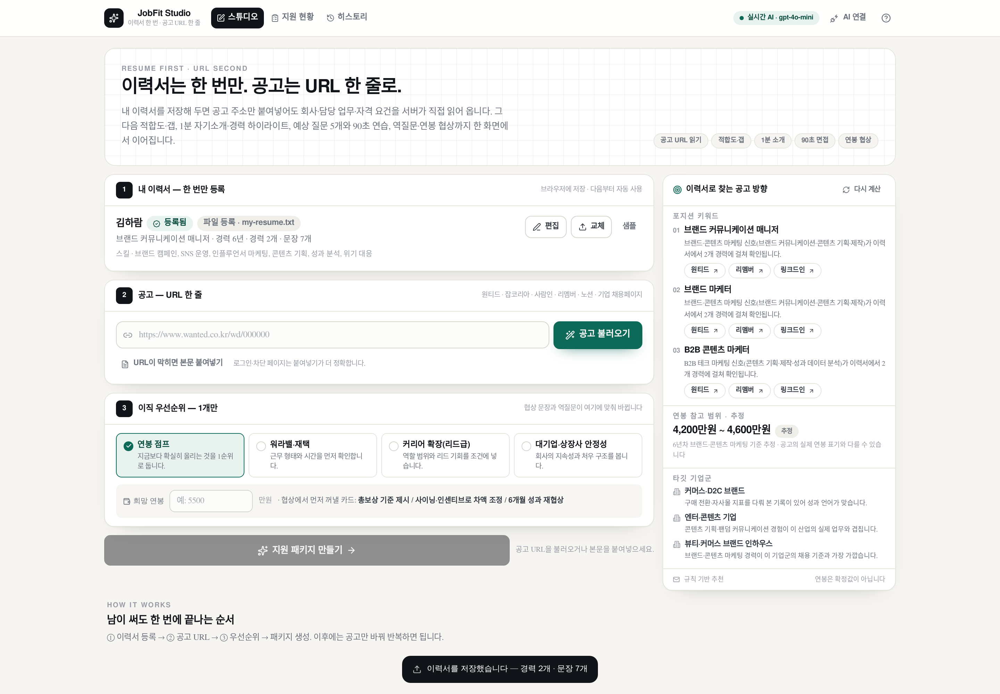
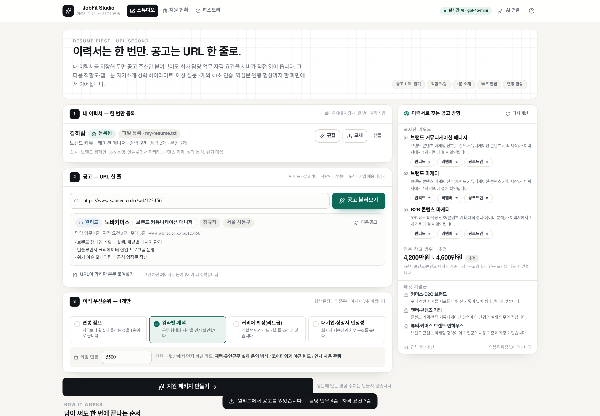
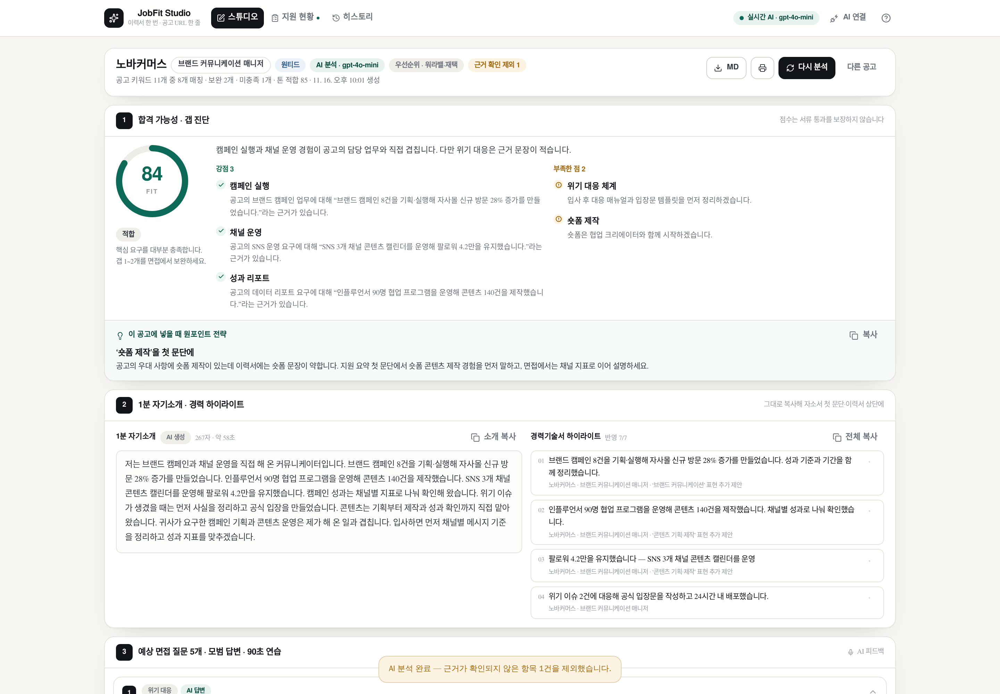
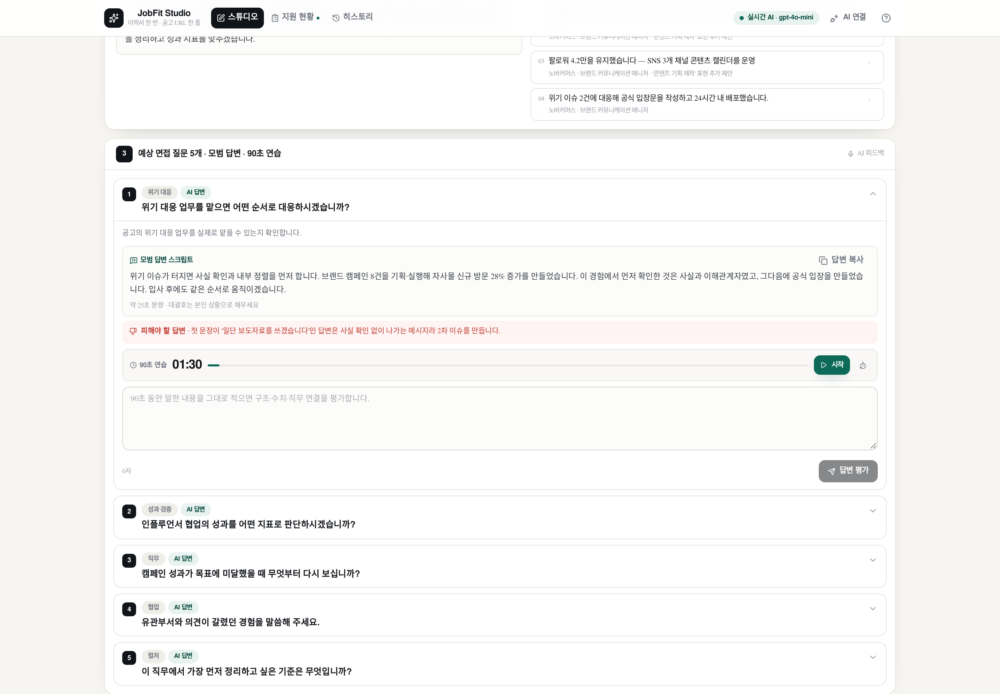
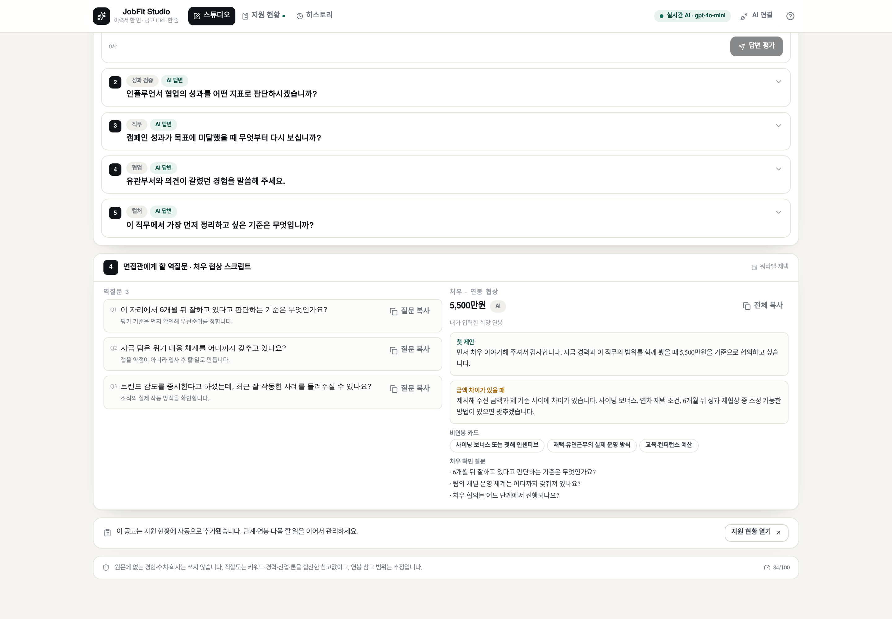
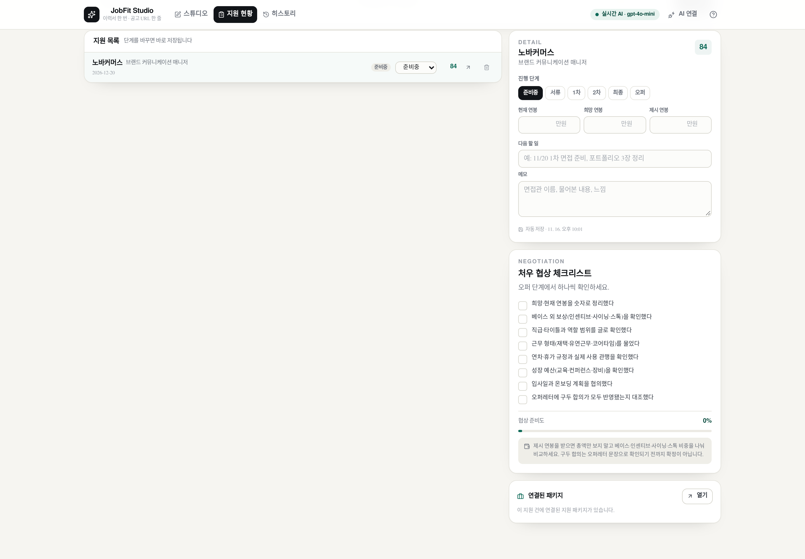
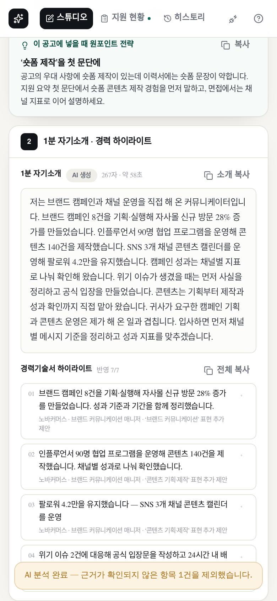

# JobFit Studio — 이력서 한 번, 공고 URL 한 줄

> **내 이력서를 한 번 올려 두면, 공고 주소만 붙여넣어도 회사·담당 업무·자격 요건을 서버가 직접 읽어 옵니다.**
> 그다음 적합도·갭 → 1분 자기소개·경력 하이라이트 → 예상 질문 5개(모범 답변 + 90초 연습) → 역질문·연봉 협상까지 한 화면에서 이어집니다.


텍스트를 복붙해서 AI에게 물어보는 도구가 아니라, **공고를 가져오고 · 내 이력서에 맞춰 분석하고 · 바로 복사해서 쓰는** 원클릭 이직 도우미입니다.

- **이력서는 1회 등록**: `.txt`/`.md`/`.pdf` 파일 또는 직접 입력. 브라우저에 저장되어 다음 공고부터는 자동으로 쓰입니다.
- **공고는 URL로**: `/api/analyze`가 원티드·잡코리아·사람인·리멤버·노션·기업 채용페이지의 본문을 직접 읽어 문단으로 나눕니다. 자동 수집이 막히면 **본문 붙여넣기 칸이 자동으로 열립니다.**
- **정직성 원칙**: 지원자 원문에 없는 경험·수치·회사는 AI도, 규칙 엔진도 만들지 않습니다.
- **AI 없이도 동작**: 키가 없으면 규칙 엔진으로 같은 흐름을 제공합니다(상단 배지가 현재 모드 표시).

---

## 공고 보드 — 여러 공고를 한 페이지에서

기본 화면은 **공고 보드**입니다. 이력서를 한 번 등록해 두고 공고를 여러 개 모아 적합도 순으로 보고, 지원 큐에서 차례로 처리합니다. 기존 1건 코칭은 각 공고의 ‘상세 코칭’으로 이어집니다.

1. **모으기** — ① URL 여러 줄 붙여넣기(한 번에 30개, 3개씩 병렬로 읽음, 추적 파라미터 제거 후 중복 제외) ② 본문 여러 개를 ‘===’ 줄로 구분해 붙여넣기 ③ 내 브라우저에서 검색 결과의 공고 링크를 한 번에 복사하는 북마클릿(원티드·사람인·잡코리아·링크드인·리멤버·점핏·캐치). 서버가 포털 검색 결과를 대신 긁지 않습니다.
2. **점수** — 공고마다 규칙 엔진으로 적합도(0~100)·강점 키워드·부족 키워드를 즉시 계산합니다. 이력서를 고치면 보드 전체가 다시 계산됩니다.
3. **고르기** — 상태(새 공고·지원 예정·지원 완료·건너뜀), 최소 점수, 마감 임박순·적합도순·최근순 정렬.
4. **지원 큐** — 상위 N건 또는 선택한 공고를 한 건씩 보여 주며 공고 맞춤 소개 문단·강조 키워드·보완 항목을 제공합니다. ‘지원 완료’를 누르면 지원 현황에 기록됩니다.
5. **자동 제출은 하지 않습니다** — 채용 사이트의 로그인·캡차·약관 때문에 대신 제출할 수 없고, 반자동(문안 준비 → 지원 페이지 열기 → 완료 기록)으로 만들었습니다.

저장은 브라우저(localStorage)입니다. 기기 간 동기화·알림·마감 메일은 계정/DB가 필요해 아직 없습니다. 공식 API(워크넷·사람인 Open API 등)는 키가 있으면 같은 보드로 넣을 수 있습니다.

---

## 1. 쓰는 순서

| | |
| --- | --- |
|  |  |
| **① 이력서 등록** — 파일(.txt/.md/.pdf) 또는 직접 입력. 경력·성과 문장이 원본으로 저장되고, 이력서만으로 포지션 키워드 3개·연봉 참고 범위·타깃 기업군 3개 + 원티드·리멤버·링크드인 검색 링크를 만듭니다. | **② 공고 URL** — 붙여넣고 ‘공고 불러오기’를 누르면 회사·직무·담당 업무·자격 요건·우대 사항을 읽어 옵니다. 아래에서 **③ 이직 우선순위**(연봉 점프 / 워라밸·재택 / 커리어 확장 / 대기업 안정성)를 1개 고르고 희망 연봉을 적습니다. |
|  |  |
| **1. 합격 가능성·갭 진단** — 0~100 점수, 강점 3, 부족한 점 2, **이 공고에 넣을 때의 원포인트 전략**(원클릭 복사) | **2. 1분 자기소개·경력 하이라이트** — 250~320자 소개와 경력기술서에 바로 넣을 문장. 글자수·예상 발화 초 표시 |
|  |  |
| **3. 예상 질문 5개** — 질문별 **모범 답변 스크립트 + 피해야 할 답변 + 90초 타이머 연습**(답변 제출 시 강점·보완점·꼬리질문) | **4. 역질문 3 + 처우·연봉 협상** — 우선순위에 맞춘 첫 제안·차액 대응 문장·비연봉 카드·처우 확인 질문 |
|  |  |
| 패키지를 만들면 **지원 현황에 자동 등록**. 단계(준비중→서류→1차→2차→최종→오퍼)·연봉·다음 할 일 관리 | 모바일 390px에서도 가로 넘침 없이 같은 흐름 |

---

## 2. 핵심 기능

| 영역 | 내용 |
| --- | --- |
| **이력서 1회 등록** | `.txt`/`.md` 파싱, **`.pdf` 텍스트 추출**(ToUnicode CMap·FlateDecode 지원, 스캔 PDF는 안내 후 .txt 권장), 직접 입력 편집 시트. `localStorage`에 저장(등록 방식·파일명·시각 기록) |
| **공고 URL 수집** | 서버에서 HTML fetch(12초·1.8MB·본문 6,000자 제한, 사설망 SSRF 차단) → JSON-LD `JobPosting`·`og:` 메타·본문 문단 분리 → 필요하면 AI가 회사·직무·담당 업무·자격 요건·우대 사항·조직 톤으로 정리. 원문에 없는 숫자가 섞이면 그 필드는 페이지 글자 기준값으로 되돌립니다 |
| **차단 사이트 대응** | `403/401/429`·비HTML·본문 부족이면 `422`와 함께 사이트별 안내. **본문 붙여넣기 칸이 자동으로 열리고**, 차단 페이지에 글자가 있으면 미리 채워 줍니다 |
| **이력서 기반 추천** | 포지션 키워드 3개(연차에 맞춘 직급 표기), **연봉 참고 범위(추정임을 명시)**, 타깃 기업군 3개 + 원티드·리멤버·링크드인 검색 링크. AI 연결 시 AI가 다시 잡습니다 |
| **이직 우선순위** | 연봉 점프 / 워라밸·재택 / 커리어 확장 / 대기업 안정성 — 자기소개 마무리, 역질문, 협상 첫 제안·차액 대응·질문이 모두 이 기준으로 바뀝니다 |
| **적합도·갭** | 0~100 점수, 4축(키워드 55%·경력/직무 18%·산업 15%·톤 12%), 강점·부족(근거 문장 포함), 원포인트 전략 |
| **경력 하이라이트** | 문장 리라이트(성과 수치 앞당김·약한 동사 교체)에서 반영분만 추려 복사. 공고 키워드는 문장을 더럽히지 않고 ‘표현 추가 제안’으로 따로 표시 |
| **예상 질문 5개** | 질문·왜 묻는지·**모범 답변 스크립트(4~5문장)**·피해야 할 답변·90초 타이머·답변 평가(강점·보완점·꼬리질문). 평가 기록은 패키지에 저장 |
| **역질문·협상** | 역질문 3(질문·의도·톤), 처우 협상(기준 금액·첫 제안·차액 대응·비연봉 카드·확인 질문) |
| **지원 현황·히스토리** | 패키지 자동 등록, 단계·연봉·협상 체크리스트 8항목, 패키지 20건 저장·비교, Markdown/인쇄 내보내기 |
| **정직성 가드** | 프롬프트 규칙 + 클라이언트 검증(`src/lib/guard.ts`): 원문에 없는 숫자·회사명이 든 문장은 폐기하고 경고 수를 남깁니다 |

---

## 3. AI 연결 (Vercel)

```
api/analyze.ts      POST /api/analyze (mode: job_url | package | interview_eval | recommend), GET /api/analyze (상태 프로브)
api/_joburl.ts      공고 URL fetch·HTML 텍스트 추출·문단 분리 (Vercel 라우트 아님: `_` 접두사)
vercel.json         build: npm run build → dist, functions.maxDuration 60s
```

### 환경변수

| 이름 | 필수 | 설명 |
| --- | --- | --- |
| `GEMINI_API_KEY` | 배포 시 권장 | Google AI Studio 키(`AQ.…` 또는 `AIza…`). 서버에서만 사용. |
| `GEMINI_MODEL` | 선택 | 기본 `gemini-3.5-flash-lite` |
| `OPENAI_API_KEY` | 선택 | Gemini 키가 없을 때 상용 OpenAI 경로 |
| `OPENAI_MODEL` | 선택 | 기본 `gpt-4o-mini` (허용: `gpt-4o-mini`, `gpt-4o`, `gpt-4.1-mini`, `gpt-4.1`) |
| `OPENAI_BASE_URL` / `GEMINI_BASE_URL` | 선택 | 프록시·게이트웨이를 쓸 때만 |
| `JOBFIT_ALLOW_LOCAL_FETCH` | 테스트 전용 | `1`이면 `127.0.0.1` 등 로컬 주소 fetch 허용(E2E 픽스처용). 운영에서는 두지 마세요. |

키가 없으면 `job_url`은 **규칙 정리**로 동작하고, 나머지 모드는 `501 no_key`를 돌려주며 앱은 규칙 엔진으로 폴백합니다.

### API 계약

```
GET  /api/analyze
→ { ok, service, version, ai, provider: "gemini"|"openai"|null, model, reason?: "no_key",
    modes: ["package","interview_eval","job_url","recommend"], urlFetch: true }

POST /api/analyze  { mode:"job_url", jobUrl, apiKey?, model? }        ← AI 키 없이도 200
→ { ok, mode, engine: "ai"|"rule", provider, model, job:{company,role,employmentType,location,deadline,
     responsibilities,requirements,preferred,tone},
    meta:{url, finalUrl, site, title, chars, note} }
→ 422 { ok:false, error:{ code:"fetch_blocked"|"fetch_failed"|"not_job_page"|"too_large", message, site, excerpt } }
→ 400 { error:{ code:"bad_url" } }

POST /api/analyze  { mode:"package", job, resume, match, priorityLabel?, targetSalary?, apiKey?, model? }
→ { ok, mode, provider, model, data:{ fit{verdict,onePoint,strengths,gaps}, intro{text,outline}, appeals[],
     rewrites[], questions[]{question,why,category,answer,avoid}, reverseQuestions[], negotiation{opener,counter,nonSalary,questions} } }

POST /api/analyze  { mode:"interview_eval", question, answer, seconds, job?, resume?, apiKey?, model? }
→ { ok, mode, provider, model, data:{ strengths[], improvements[], followUp, followUpWhy, score, verdict } }

POST /api/analyze  { mode:"recommend", resume, priorityLabel?, apiKey?, model? }
→ { ok, mode, provider, model, data:{ titles[{title,why}], salaryBand{min,max,basis}, targets[{group,why}] } }
```

- 키 우선순위: `GEMINI_API_KEY` → `OPENAI_API_KEY` → 요청 `apiKey`(서버 키가 없을 때만, `sk-…`가 아니면 Gemini) → `501 no_key`
- JSON 모드, 본문 60,000자 / 필드 3,500자 / 답변 3,000자 제한, CORS(`*`, OPTIONS 204)
- 공고 URL fetch: 12초 타임아웃, 1.8MB·본문 6,000자 제한, 리다이렉트 후 최종 호스트 재검사, 사설망·로컬 차단
- 입력과 키는 저장하지 않습니다.

---

## 4. 실행

```bash
npm install
npm run dev        # http://localhost:5183 (서버가 없으므로 공고 URL은 본문 붙여넣기로 안내)
npm run build      # tsc --noEmit + tsc -p tsconfig.api.json + vite build
npm run preview    # 빌드 결과 확인
```

### AI·URL 수집까지 로컬에서 보기

```bash
npm i -g vercel
vercel dev         # .env.local 에 GEMINI_API_KEY(또는 OPENAI_API_KEY)를 두면 실시간 AI + 공고 URL 수집
```

### 테스트

```bash
python3 scripts/verify.py     # Playwright E2E 165개 검사 (모의 서버 5종: OpenAI·Gemini·키 없음·정적 호스팅·사설망 차단)
node scripts/test-pdf.mjs     # 한글 PDF 텍스트 추출 단위 테스트
python3 make-pdf-fixture.py   # (scripts/) PDF 픽스처 재생성
python3 scripts/shots.py      # docs/screenshots 재생성
```

`scripts/e2e-server.mjs`가 `dist/`를 서빙하면서 실제 `api/analyze.ts`를 esbuild로 실행하고, 공고 페이지(`wanted.co.kr` 요청 → `scripts/fixtures/job-page.html`)와 AI 응답만 스텁합니다. 픽스처의 인물·기업은 모두 가상입니다.

---

## 5. 배포

- **Vercel**: 저장소를 연결하면 `vercel.json` 설정으로 `dist` + `api/analyze.ts`가 함께 배포됩니다. `GEMINI_API_KEY`를 넣고 재배포하면 배지가 ‘실시간 AI’로 바뀌고 공고 URL 수집이 켜집니다.
- **GitHub Pages**: `.github/workflows/deploy.yml` + `vite.config.ts`의 `GITHUB_ACTIONS` base 분기로 정적 배포도 지원합니다. 서버가 없으므로 공고 URL은 안내 문구와 함께 **본문 붙여넣기**로 동작하고, 분석은 규칙 엔진으로 돌아갑니다.

---

## 6. 데이터·한계

- 이력서·공고·패키지·지원 현황·연습 기록은 **브라우저 localStorage**에만 저장됩니다(패키지 20건, 지원 건 60건).
- 공고 URL은 **공개 페이지**만 읽습니다. 로그인 필요·자동 수집 차단 사이트는 본문 붙여넣기를 사용하세요(같은 분석을 받습니다).
- AI 분석은 입력 내용을 Gemini/OpenAI로 전송합니다. 실제 회사 기밀, 타인의 개인정보, 채용 사이트의 비공개 자료는 넣지 마세요.
- 적합도 점수는 참고값이며 서류 통과를 보장하지 않습니다. **연봉 참고 범위는 추정**이고, 협상 문장에 들어가는 금액은 입력한 희망 연봉만 씁니다.
- PDF는 글자로 된 문서만 읽습니다(스캔 이미지·암호화 PDF는 안내 후 .txt/.md 권장).
- AI 출력은 사후 검증(수치·회사명 대조)을 거치지만, 제출 전 모든 문장과 수치는 지원자가 직접 확인해야 합니다.
