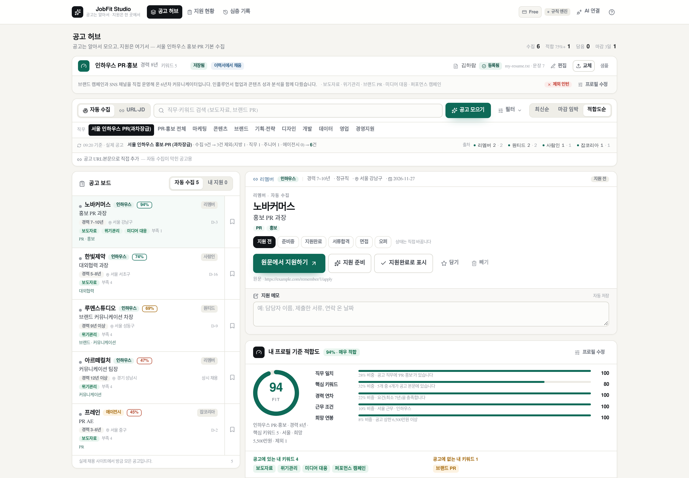
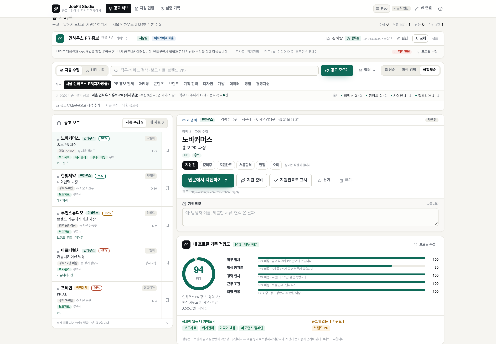
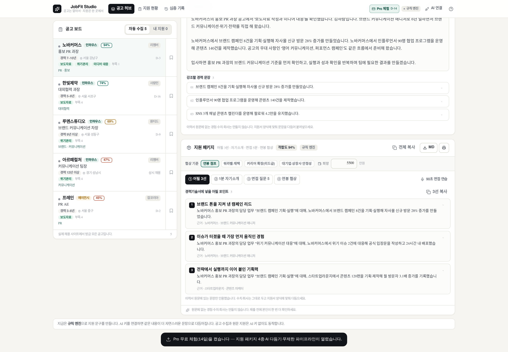
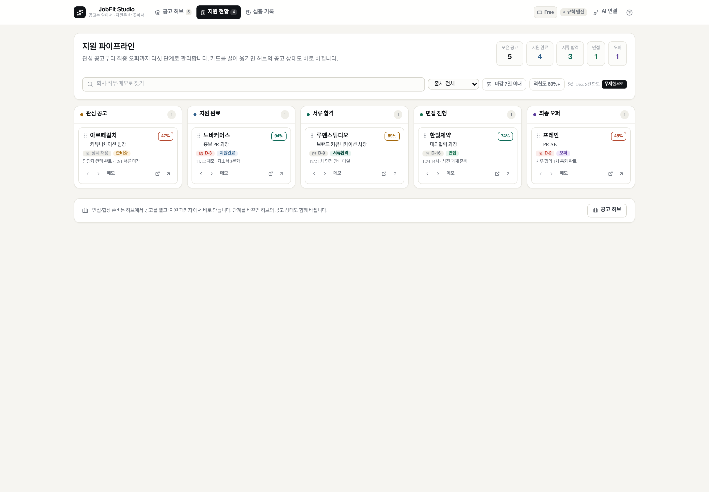
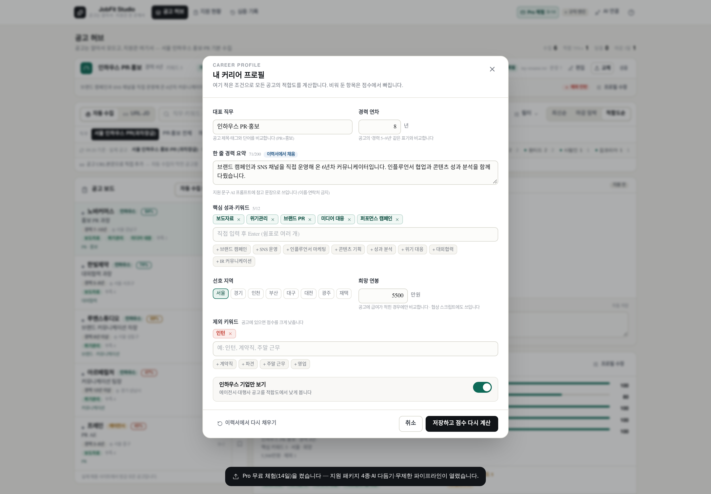
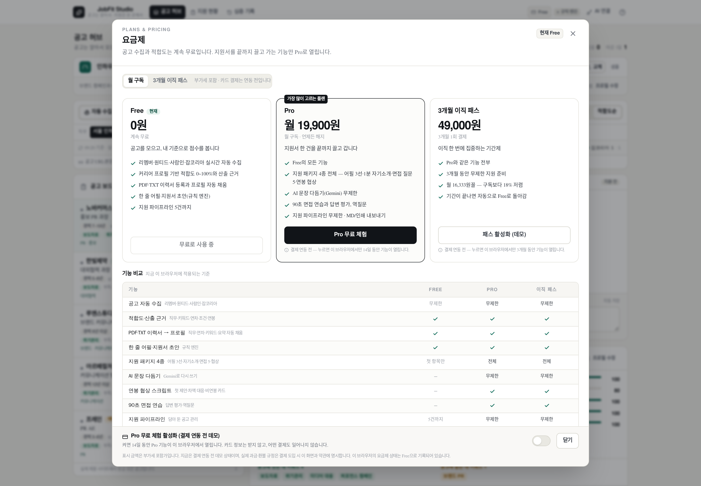
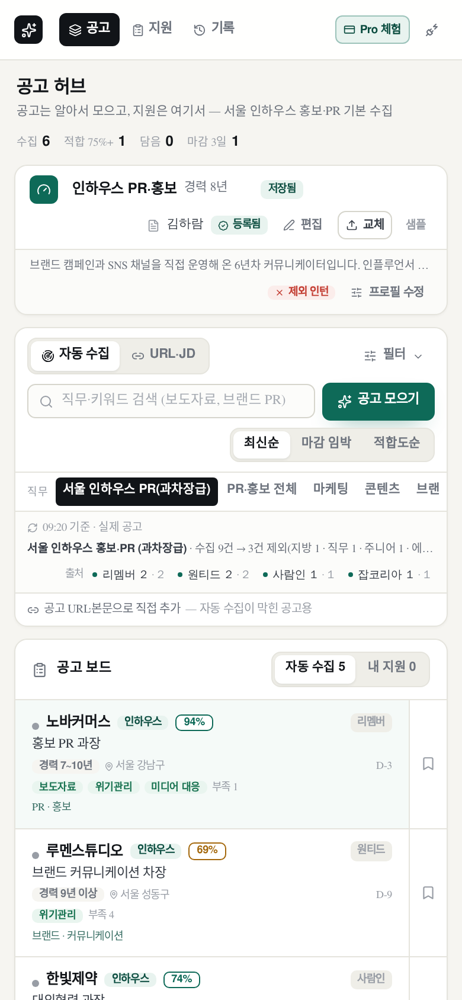
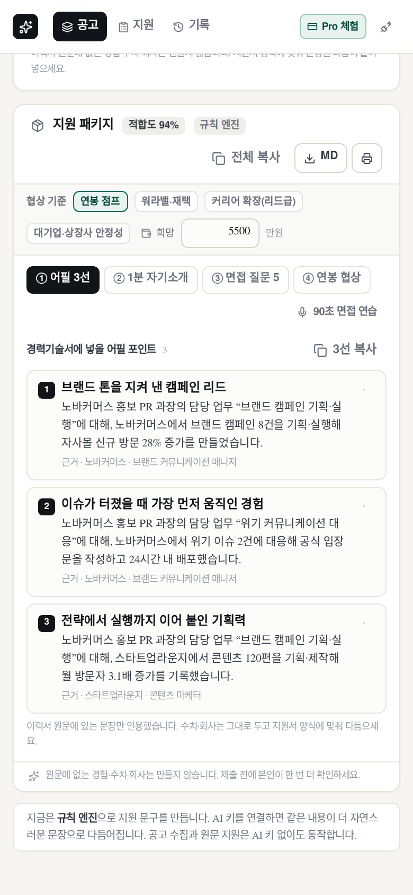

# JobFit Studio — 공고는 알아서 모으고, 지원은 한 곳에서

> **첫 화면에서 리멤버·원티드·사람인·잡코리아의 실제 공고를 모아, 서울 인하우스 홍보·PR 과차장급만 남깁니다.**
> 내 **커리어 프로필**(직무·경력 연차·핵심 키워드·희망 연봉·제외 키워드)로 공고마다 **적합도 0~100%**를 계산하고, 점수의 비중·근거와 맞는 키워드·빠진 키워드를 그대로 보여 줍니다.
> 카드를 고르면 **지원 패키지**(경력기술서 어필 3선 · 1분 자기소개 · 예상 면접 질문 5개와 답변 전략 · 연봉 협상 스크립트)가 바로 나오고, **지원 파이프라인**(관심 공고 → 지원 완료 → 서류 합격 → 면접 진행 → 최종 오퍼)에서 D-day와 메모로 관리합니다.



**요금제**는 `Free` / `Pro 월 19,900원` / `3개월 이직 패스 49,000원` 세 가지입니다. 공고 수집·적합도·이력서 파싱은 계속 무료이고, 지원서를 끝까지 끌고 가는 기능(지원 패키지 4종 전체·AI 다듬기·연봉 협상·무제한 파이프라인)만 Pro로 열립니다. 결제(PG)는 아직 붙이지 않았고, 화면에서 **Pro 무료 체험(데모)** 을 켜면 실제 잠금이 풀리는 것을 그대로 확인할 수 있습니다.

공고 URL을 하나씩 찾아다니며 복사할 필요 없이, **직무/키워드만 고르면 보드가 실제 공고로 채워지고 지원 준비와 직접 지원까지 이어지는 커리어 허브**입니다.

- **공고 자동 수집**: 첫 화면 프리셋 1순위가 **「서울 인하우스 PR(과차장급)」**입니다. 리멤버·원티드·사람인·잡코리아 네 곳을 여러 검색어로 한 번에 조회한 뒤, **서울·인하우스·홍보/PR·경력 5년 이상**만 남기고 지방·에이전시·신입·다른 직무 공고를 걸러 냅니다. 무엇이 몇 건 빠졌는지 화면에 그대로 표시합니다. 다른 직무 프리셋(PR·홍보 전체, 마케팅, 콘텐츠, 브랜드, 기획·전략, 디자인, 개발, 데이터, 영업, 경영지원)이나 직접 입력한 키워드로 다시 모을 수 있습니다.
- **공고 원문에서 직접**: 회사·직무·경력·지역·마감일과 **원문 지원 링크**를 채용 사이트의 공개 응답에서 읽습니다. 리멤버·원티드는 담당 업무·자격 요건·우대 사항 본문까지, 사람인·잡코리아는 목록의 조건·직무 태그까지 읽고, 필요하면 카드에서 ‘원문에서 요건 읽어오기’로 본문을 더 채웁니다. 없는 항목은 만들지 않습니다.
- **이력서는 1회 등록 → 프로필은 자동으로**: `.txt`/`.md`/`.pdf`를 올리면 브라우저에서 PDF 글자를 직접 뽑아(ToUnicode CMap·FlateDecode) 경력·성과 문장을 나누고, **대표 직무·경력 연차·핵심 키워드·한 줄 요약을 커리어 프로필에 그대로 채웁니다.** 이미 넣어 둔 값은 건드리지 않고 빈 항목만 채우며, 어디서 채웠는지 화면에 표시합니다.
- **지원 문구**: 규칙 엔진이 이력서 문장을 골라 한 줄 어필·지원서 3문단 초안·강조 경력 문장을 즉시 만들고, AI(Gemini `gemini-3.5-flash-lite`)가 연결되면 자동으로 한 번 더 다듬습니다. 원문에 없는 수치·회사명은 사후 검증에서 걸러냅니다.
- **커리어 프로필·적합도**: 직무·경력 연차·핵심 키워드·선호 지역·희망 연봉·제외 키워드를 저장하면, 모든 공고를 같은 기준으로 채점해 카드에 `94%`처럼 표시합니다. 카드를 열면 항목별 비중·점수·근거와 공고에 있는/없는 내 키워드가 그대로 나옵니다.
- **지원 패키지**: 카드에서 경력기술서 어필 3선·1분 자기소개·예상 면접 질문 5개와 답변 전략·연봉 협상 스크립트를 한 번에 만들고, 항목별 복사·전체 복사·Markdown·인쇄로 내보냅니다. 90초 면접 연습과 역질문은 ‘90초 면접 연습’으로 이어집니다.
- **직접 지원·파이프라인**: 카드의 ‘원문에서 지원하기’가 실제 공고/지원 페이지를 새 탭으로 엽니다. 지원 후 단계를 옮기면 지원 파이프라인과 허브 상태가 함께 바뀌고, 마감 D-day·메모가 남습니다.
- **URL·JD 직접 분석**: 자동 수집이 막힌 공고는 수집 바의 ‘공고 URL·JD 직접 분석’ 탭에 주소나 본문을 넣으면 같은 적합도·지원 패키지를 만듭니다.

---

## 1. 쓰는 순서

| | |
| --- | --- |
|  |  |
| **① 프로필만 정하면 공고마다 적합도** — 서울 인하우스 홍보·PR 과차장급을 자동 수집하고, 내 프로필과 비교해 점수·맞는 키워드·빠진 키워드를 카드에 바로 표시합니다. 정렬은 최신·마감 임박·적합도순. | **② 점수의 근거를 숨기지 않음** — 직무 일치·핵심 키워드·경력 연차·근무 조건·희망 연봉의 비중과 점수, 공고에 있는/없는 키워드를 그대로 보여 줍니다. |
|  |  |
| **③ 지원 패키지 4종** — 경력기술서 어필 3선, 1분 자기소개, 예상 질문 5개와 답변 전략, 연봉 협상 스크립트. 항목별 복사·전체 복사·MD·인쇄. | **④ 지원 파이프라인** — 관심 공고 → 지원 완료 → 서류 합격 → 면접 진행 → 최종 오퍼. 카드를 끌어 옮기고, 마감 D-day·적합도·메모로 관리합니다. |
|  |  |
| **⑤ 커리어 프로필** — 직무·연차·한 줄 요약·핵심 키워드·선호 지역·희망 연봉·제외 키워드를 저장하면 모든 공고의 점수가 같은 기준으로 다시 계산됩니다. 이력서를 올리면 빈 항목은 자동으로 채워집니다. | **⑥ 요금제** — Free/Pro/이직 패스, 기능 비교표, FAQ, Pro 무료 체험 스위치. 결제 연동 전 데모임을 화면에 명시합니다. |
|  |  |
| 모바일 390px에서도 같은 동선 — 수집 → 적합도 → 지원 패키지 → 파이프라인. 가로 넘침 0. | 모바일에서도 지원 패키지 4종을 같은 탭으로 봅니다. |

---

## 2. 핵심 기능

| 영역 | 내용 |
| --- | --- |
| **공고 자동 수집** | `POST /api/jobs` — 리멤버 `career-api.rememberapp.co.kr/job_postings/search`(본문 포함), 원티드 `api/v4/jobs`·`api/v4/jobs/{id}`, 사람인 `zf_user/search`, 잡코리아 `Search/`를 서버에서 직접 읽습니다. 네 곳을 동시에 조회하고, 한 곳이 막히거나 늦어도 나머지로 응답하며 소스별 건수를 표시합니다. 5분 캐시 |
| **기본 타깃 프로필** | `profile: "seoul-inhouse-pr"`이면 검색어 6개(홍보·PR·언론홍보·기업PR·커뮤니케이션·대외협력)로 모은 뒤 **서울 · 인하우스 · 홍보/PR 직무 · 경력 5년 이상(과차장급)** 만 남깁니다. PR 에이전시·대행사는 빼고, 서치펌(헤드헌팅) 공고는 고용주가 공개되지 않아 별도 배지로 구분합니다. `filter`에 원본·유지·제외(지방/직무/신입·주니어/에이전시) 건수를 함께 돌려줍니다 |
| **중복 제거** | 소스+공고번호, 그리고 회사·직무 조합으로 중복을 걸러 한 공고가 두 번 보이지 않습니다. 실제로 응답한 그대로만 보여 주고 없는 공고를 만들지 않습니다 |
| **공고 파싱** | 원티드 본문의 `main_tasks`·`requirements`·`preferred_points`를 주요 업무·자격 요건·우대 사항으로, 사람인·잡코리아는 경력·학력·고용형태·급여·지역·직무 태그·마감을 목록에서 읽습니다. 목록만 읽은 공고는 카드에서 ‘원문에서 요건 읽어오기’(기존 URL 파서)로 본문을 채웁니다 |
| **원문 지원 링크** | 공고마다 실제 주소(원티드 `/wd/{id}`, 사람인 `rec_idx`, 잡코리아 `GI_Read`)를 남깁니다. 수동 URL 수집은 페이지 앵커의 ‘지원하기·입사지원’ 링크를 점수화해 직접 지원 링크를 뽑고, 없으면 공고 URL을 씁니다. AI가 만든 링크는 받지 않습니다 |
| **수집 실패 안내** | 모든 소스가 응답하지 않으면 `502 sources_blocked`와 함께 화면에 이유·‘다시 시도’를 보여 줍니다. 조건에 맞는 공고가 없으면 `no_result`로 안내하고 다른 직무를 권합니다 |
| **담기·저장** | 자동 수집분은 화면에만 있고, 북마크하거나 상태·메모·제출서류 체크를 남긴 공고만 localStorage에 저장됩니다(최대 60건). 다음 방문에 다시 모아도 담은 공고는 그대로 남습니다 |
| **차단 사이트 대응 · URL·JD 탭** | 수집 바의 **‘공고 URL·JD 직접 분석’ 탭**에서 주소를 여러 개 넣거나 공고 본문을 붙여넣으면, 자동 수집이 막힌 공고도 같은 적합도·지원 패키지를 만듭니다. `403/401/429`·비HTML·본문 부족이면 `422`와 사이트별 안내와 함께 본문 칸이 열립니다. 사람인 상세는 로그인 후 본문이 열려 원문 확인을 안내합니다 |
| **이력서 1회 등록 · 프로필 자동 채움** | `.txt`/`.md` 파싱, **`.pdf` 텍스트 추출**(ToUnicode CMap·FlateDecode, 스캔·암호화 PDF는 안내), 직접 입력 편집 시트. 파일을 올리면 대표 직무(직함/한 줄 소개) · 경력 연차 · 핵심 키워드(이력서가 적은 스킬 + 본문에서 확인된 직무 어휘) · 한 줄 요약을 **커리어 프로필에 자동으로 채웁니다**. 비어 있는 항목만 채우고 기존 값은 유지하며, `origin: resume`으로 출처를 남깁니다. `localStorage`에 저장 |
| **지원 문구(규칙)** | 이력서 문장과 공고 키워드의 겹침으로 강조 문장을 고르고, 공고의 첫 업무·우대/자격 항목을 인용해 한 줄 어필·3문단 지원서 초안을 만듭니다. 모든 수치는 이력서 원문 값만 사용 |
| **지원 문구(AI)** | `apply_kit` 모드 — `gemini-3.5-flash-lite`. 카드를 처음 열 때 규칙 문안을 즉시 보여 주고, AI가 연결돼 있으면 자동으로 한 번 다듬습니다. 목록만 수집한 공고도 회사·직무·조건으로 문구를 만듭니다. 숫자·회사명 사후 검증(`src/lib/guard.ts`)에서 걸린 항목은 규칙 문장으로 되돌리고 개수를 표시 |
| **커리어 프로필** | 직무·경력 연차·핵심 키워드(최대 12)·선호 지역·희망 연봉·제외 키워드·인하우스 선호를 `localStorage`에 저장합니다. 저장 전에는 이력서에서 확인되는 값만 초안으로 씁니다 |
| **적합도 0~100%** | 직무 일치 28% · 핵심 키워드 32% · 경력 연차 22% · 근무 조건 10% · 희망 연봉 8%의 가중 평균(값이 없는 항목은 빼고 나머지로 100%를 맞춤). 동의어 사전으로 `PR=홍보=커뮤니케이션`을 같은 말로 보고, 공고에 없는 내 키워드는 ‘부족’으로 표시합니다. 제외 키워드가 걸리면 32점 이하, 인하우스 선호인데 에이전시 공고면 45점 이하로 낮춥니다 |
| **직접 지원·상태** | ‘원문에서 지원하기’ → 원문 링크 새 탭. 상태 6단계(지원 전·준비중·지원완료·서류합격·면접·오퍼), 지원 메모, 제출서류 체크. 모두 localStorage에 자동 저장 |
| **지원 파이프라인** | 5열 칸반(관심 공고 → 지원 완료 → 서류 합격 → 면접 진행 → 최종 오퍼). 끌어 옮기기·화살표로 단계 변경, 카드마다 마감 D-day·적합도·메모, 회사·직무·메모 검색, 출처·마감 7일 이내·적합도 60%+ 필터, 단계별 건수 요약 |
| **지원 패키지** | ① 경력기술서 어필 3선(같은 문장을 두 번 인용하지 않음) ② 1분 자기소개(자수·예상 말하기 초) ③ 예상 면접 질문 5개 + 의도·모범 답변·피해야 할 답변 ④ 연봉 협상 스크립트(첫 제안·차액 대응·비연봉 카드·확인 질문). 항목별 복사·전체 복사, Markdown 내려받기, 인쇄용 시트. AI가 연결되면 같은 내용을 더 자연스러운 문장으로 다듬습니다 |
| **심층 준비(보조)** | 예상 질문 90초 타이머·답변 평가, 역질문 3개, 우선순위별 협상. 패키지 20건 저장·비교 |
| **요금제 · 플랜 잠금** | `src/lib/plan.ts`가 Free/Pro/패스의 기능 경계를 정의합니다. Free: 수집·적합도·이력서→프로필·지원 문구 초안·파이프라인 5건. Pro/패스: 지원 패키지 4종 전체, AI 다듬기, 연봉 협상 스크립트, 90초 면접 연습, 무제한 파이프라인. 헤더 배지 → 요금제 창(3개 카드·기능 비교표·FAQ·Pro 무료 체험 스위치). 결제는 연동 전 데모이며 주문·과금은 일어나지 않습니다 |
| **정직성 가드** | 프롬프트 규칙 + 클라이언트 검증: 원문에 없는 숫자·회사명이 든 문장은 폐기하고 경고 수를 남깁니다 |

---

## 3. 서버 (Vercel)

```
api/jobs.ts         GET|POST /api/jobs — 실제 공고 자동 수집 (리멤버·원티드·사람인·잡코리아)
api/_collect.ts     수집기: 소스별 요청·파싱·중복 제거·소스 리포트 (Vercel 라우트 아님: `_` 접두사)
api/_target.ts      기본 타깃 프로필 규칙: 서울·인하우스·홍보/PR·과차장급 판정과 에이전시/서치펌 구분
api/analyze.ts      POST /api/analyze (mode: job_url | apply_kit | package | interview_eval | recommend), GET /api/analyze (상태 프로브)
api/_joburl.ts      공고 URL fetch·HTML 텍스트 추출·문단 분리·지원 링크 추출 (Vercel 라우트 아님: `_` 접두사)
vercel.json         build: npm run build → dist, functions.maxDuration 60s (analyze·jobs)
```

### 환경변수

| 이름 | 필수 | 설명 |
| --- | --- | --- |
| `GEMINI_API_KEY` | 배포 시 권장 | Google AI Studio 키(`AQ.…` 또는 `AIza…`). 서버에서만 사용 |
| `GEMINI_MODEL` | 선택 | 기본 `gemini-3.5-flash-lite` |
| `OPENAI_API_KEY` | 선택 | Gemini 키가 없을 때 상용 OpenAI 경로 |
| `OPENAI_MODEL` | 선택 | 기본 `gpt-4o-mini` (허용: `gpt-4o-mini`, `gpt-4o`, `gpt-4.1-mini`, `gpt-4.1`) |
| `OPENAI_BASE_URL` / `GEMINI_BASE_URL` | 선택 | 프록시·게이트웨이를 쓸 때만 |
| `JOBFIT_ALLOW_LOCAL_FETCH` | 테스트 전용 | `1`이면 `127.0.0.1` 등 로컬 주소 fetch 허용(E2E 픽스처용). 운영에서는 두지 마세요 |

**공고 자동 수집은 AI 키 없이 동작합니다.** 키가 없으면 `apply_kit`·`package`·`recommend`는 `501 no_key`를 돌려주며 앱은 규칙 문안으로 폴백합니다.

### API 계약

```
GET  /api/jobs?ping=1
→ { ok, service: "jobfit-jobs", version, sources: ["remember","wanted","saramin","jobkorea"], profiles: ["seoul-inhouse-pr"] }

GET  /api/jobs?q=홍보&limit=36&detail=12
GET  /api/jobs?profile=seoul-inhouse-pr
POST /api/jobs  { q: "홍보", limit: 36, detail: 12 }
POST /api/jobs  { profile: "seoul-inhouse-pr", limit: 60, detail: 8 }
→ { ok, query, jobs: [{
      id: "remember:355613", source: "remember", sourceName: "리멤버", sourceJobId,
      company, role, employmentType, experience, location, deadline, salary, tags[],
      responsibilities, requirements, preferred, documents,
      url, applyUrl, detailLevel: "full"|"list", conditions,
      companyType: "inhouse"|"searchfirm"|"agency", minYears, maxYears }],
    sources: [{ id, name, ok, count, full, ms, note? }],
    filter?: { profile, label, raw, kept, excluded:{region,role,junior,agency} },
    fetchedAt, cached?, service, version }
→ 200 { ok:false, error:{ code:"no_result", message } }   조건에 맞는 공고 없음
→ 502 { ok:false, error:{ code:"sources_blocked", message } } 모든 소스 응답 실패
→ 400 bad_body · 405 method_not_allowed

GET  /api/analyze
→ { ok, service, version, ai, provider: "gemini"|"openai"|null, model, reason?: "no_key",
    modes: ["package","interview_eval","job_url","recommend","apply_kit"], urlFetch: true }

POST /api/analyze  { mode:"job_url", jobUrl, apiKey?, model? }        ← AI 키 없이도 200
→ { ok, mode, engine: "ai"|"rule", provider, model,
    job:{company,role,employmentType,location,deadline,responsibilities,requirements,preferred,
         documents,applyUrl,applyLabel,tone},
    meta:{url, finalUrl, site, title, chars, note} }
→ 422 { ok:false, error:{ code:"fetch_blocked"|"fetch_failed"|"not_job_page"|"too_large", message, site, excerpt } }
→ 400 { error:{ code:"bad_url" } }

POST /api/analyze  { mode:"apply_kit", job, resume, apiKey?, model? }
→ { ok, mode, provider, model, data:{ oneLiner, coverLetter, keyPoints[] } }

POST /api/analyze  { mode:"package", job, resume, match, priorityLabel?, targetSalary?, profile?, apiKey?, model? }
→ { ok, mode, provider, model, data:{ fit{verdict,onePoint,strengths,gaps}, intro{text,outline}, appeals[],
     rewrites[], questions[]{question,why,category,answer,avoid}, reverseQuestions[], negotiation{opener,counter,nonSalary,questions} } }

POST /api/analyze  { mode:"interview_eval", question, answer, seconds, job?, resume?, apiKey?, model? }
→ { ok, mode, provider, model, data:{ strengths[], improvements[], followUp, followUpWhy, score, verdict } }

POST /api/analyze  { mode:"recommend", resume, priorityLabel?, apiKey?, model? }
→ { ok, mode, provider, model, data:{ titles[{title,why}], salaryBand{min,max,basis}, targets[{group,why}] } }
```

- 키 우선순위: `GEMINI_API_KEY` → `OPENAI_API_KEY` → 요청 `apiKey`(서버 키가 없을 때만, `sk-…`가 아니면 Gemini) → `501 no_key`
- JSON 모드, 본문 60,000자 / 필드 3,500자 / 답변 3,000자 제한, CORS(`*`, OPTIONS 204)
- 공고 URL fetch: 12초 타임아웃, 1.8MB·본문 6,000자 제한, 리다이렉트 후 최종 호스트 재검사, 사설망·로컬 차단
- 자동 수집: 소스별 8~12초 타임아웃, 전체 18초 예산, 5분 인메모리 캐시, 키워드는 30자·제어문자 제거
- `package`의 `profile`(직무·연차·핵심 키워드·제외 키워드)은 강조점과 협상 관점을 정하는 데만 쓰고, 지원자 원문에 없는 사실을 더하지 않도록 프롬프트에서 제한합니다.
- 입력과 키는 저장하지 않습니다.

### 수집 소스 검증 (2026-11-19)

| 소스 | 엔드포인트 | 결과 |
| --- | --- | --- |
| 리멤버 | `career-api.rememberapp.co.kr/job_postings/search` (POST) | 200. 로그인 없이 검색어별 30건×2페이지(최대 93건), 담당 업무·자격 요건·우대 사항 본문 포함. 공고 원문 `career.rememberapp.co.kr/job/posting/{id}` |
| 원티드 | `/api/v4/jobs`, `/api/v4/jobs/{id}` | 목록·키워드 검색·본문 요건 모두 200. 기본 24건, 본문 12건 상세 |
| 사람인 | `/zf_user/search` | 목록 HTML 200. 회사·직무·경력·학력·고용형태·급여·지역·직무태그·마감 (상세 본문은 로그인 필요) |
| 잡코리아 | `/Search/` | 목록 HTML 200. 회사·직무·경력·지역·직무태그 |
| 로켓펀치 | `/api/jobs` | 403 Cloudflare 챌린지 — 사용하지 않음 |
| 점핏 | `api.jumpit.co.kr/api/positions` | 목록은 열리지만 키워드가 회사명으로만 걸려 직무 검색 불가 — 사용하지 않음 |

---

## 4. 실행

```bash
npm install
npm run dev        # http://localhost:5183 (정적 dev에는 수집·AI 서버가 없어 안내 문구가 뜹니다)
npm run build      # tsc --noEmit + tsc -p tsconfig.api.json + vite build
npm run preview    # 빌드 결과 확인
```

### 수집·AI까지 로컬에서 보기

```bash
npm i -g vercel
vercel dev         # .env.local 에 GEMINI_API_KEY(또는 OPENAI_API_KEY)를 두면 실시간 AI + 공고 수집·URL 수집
```

### 테스트

```bash
python3 scripts/verify.py       # Playwright E2E (모의 서버 5종: OpenAI·Gemini·키 없음·정적 호스팅·사설망 차단, 173개 확인)
python3 scripts/check-v2.py     # 커리어 프로필·적합도·지원 패키지·파이프라인·요금제 화면 검사 (고정 예시 공고, 56개 확인)
node scripts/test-pdf.mjs       # 한글 PDF 텍스트 추출 단위 테스트
python3 scripts/make-pdf-fixture.py
python3 scripts/shots.py        # docs/screenshots 재생성 (고정 예시 공고)
```

`scripts/e2e-server.mjs`가 `dist/`를 서빙하면서 실제 `api/analyze.ts`·`api/jobs.ts`를 esbuild로 실행합니다. 공고 자동 수집은 **실제 리멤버·원티드·사람인·잡코리아 응답**을 그대로 검증하고, 수동 URL 수집 픽스처(`wanted.co.kr/wd/…`, `jobkorea.co.kr/Recruit/GI_Read/987654`)와 AI 응답만 스텁합니다. 픽스처의 인물·기업은 모두 가상입니다.

---

## 5. 배포

- **Vercel**: 저장소를 연결하면 `vercel.json` 설정으로 `dist` + `api/analyze.ts` + `api/jobs.ts`가 함께 배포됩니다. `GEMINI_API_KEY`를 넣고 재배포하면 배지가 ‘실시간 AI’로 바뀌고 지원 문구 AI가 켜집니다.
- **GitHub Pages**: `.github/workflows/deploy.yml` + `vite.config.ts`의 `GITHUB_ACTIONS` base 분기로 정적 배포도 지원합니다. 서버가 없으므로 자동 수집은 안내 문구를 띄우고, 공고는 **URL·본문 직접 추가**로 넣으며 지원 문구는 규칙 엔진으로 만듭니다.

### 화면 설계 (v8)

- 첫 화면 위쪽을 **작업대 한 줄**로 접었습니다: 커리어 프로필 요약(직무·연차·키워드·저장 상태)과 이력서 줄이 한 카드에 있고, 그 아래 **2탭 수집 바**(자동 수집 / URL·JD)와 접히는 필터(지역·경력·적합도·제외 키워드)만 둡니다. 정렬은 항상 보이는 한 줄, 출처 건수는 점으로 구분한 메타 줄입니다.
- 카드 모서리·칩 반경을 줄이고 그림자를 없애 평평한 1px 경계와 헤어라인 구분선만 씁니다. 색이 있는 아이콘 사각형과 영문 eyebrow 라벨을 걷어내고 9.5~12px 본문 위계로 밀도를 올렸습니다. 아이콘은 전부 lucide SVG입니다(이모지 없음).
- 상세 화면의 출처·고용형태·지역·마감 칩 6개를 한 줄 메타 텍스트로 합쳐, 카드마다 반복되던 알약 줄을 없앴습니다.

---

## 6. 데이터·한계

- 이력서·커리어 프로필·담은 공고·지원 문구·상태·메모·심층 패키지는 **브라우저 localStorage**에만 저장됩니다(담은 공고 60건, 패키지 20건). 자동 수집분은 담거나 상태·메모를 남겨야 저장됩니다. 서버로 보내지 않습니다.
- 자동 수집은 **공개 목록/검색 응답**만 읽습니다. 사이트가 응답을 막거나 형식을 바꾸면 소스별 건수가 0으로 표시되고 나머지 소스로 동작합니다.
- 사람인 상세 페이지 본문은 로그인 후 열려 자동 수집이 닿지 않습니다. 목록의 조건·직무 태그를 보여 주고 원문 확인을 안내합니다.
- 지원 링크는 공개 공고 주소(리멤버 `/job/posting/{id}`, 원티드 `/wd/`, 사람인 `rec_idx`, 잡코리아 `GI_Read`)입니다. 리멤버 공고가 외부 지원 페이지를 쓰면 그 주소를 씁니다. 공고가 앱 안에서만 지원을 받으면 공고 URL로 열립니다.
- AI는 입력 내용을 Gemini/OpenAI로 전송합니다. 실제 회사 기밀, 타인의 개인정보, 채용 사이트의 비공개 자료는 넣지 마세요.
- 지원 문구는 **초안**입니다. 제출 전 모든 문장과 수치를 지원자가 직접 확인해야 하며, AI 출력은 수치·회사명 사후 검증을 거칩니다.
- 적합도는 저장한 커리어 프로필과 공고 원문만 비교한 참고값이며, 서류 통과를 보장하지 않습니다. 계산에 쓴 비중·근거를 화면에 그대로 표시합니다. **연봉 참고 범위는 추정**이고, 협상 문장에 들어가는 금액은 입력한 희망 연봉만 씁니다.
- PDF는 글자로 된 문서만 읽습니다(스캔 이미지·암호화 PDF는 안내 후 .txt/.md 권장). 글자가 없거나 글꼴 표를 못 읽으면 .txt/.md로 저장해 올리도록 안내하고, 이력서는 그대로 두지 않습니다.
- 요금제는 **결제 연동 전 데모**입니다. 플랜 상태(Free/Pro/패스, 체험 만료일)는 이 브라우저에만 저장되고 서버·영수증과 대조하지 않습니다. 실제 과금·환불 규정은 PG 연동 시 약관과 요금제 화면에 명시합니다.
